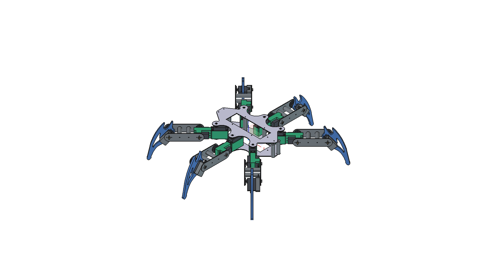

# Lasius Hexapod Control Software

Modular control software, 3D Digital Twin, REST/WebSocket control API, and teleoperation system for an 18-DOF, 6-legged (hexapod) biomimetic walking robot.

<p align="center">
  
</p>

Lasius combines embedded locomotion control, real-time 3D visualization, physical CAD engineering, and teleoperation into a single unified monorepo. The robot features a dual carbon-fiber sandwich chassis, 18 metal-gear servos driven by dual PCA9685 PWM controllers, closed-form 3-DOF inverse kinematics, a smooth 50 Hz harmonic cosine walking engine, and an interactive browser-based Digital Twin built with Vue 3 and Three.js.

---

## Folder Architecture

The repository is organized into focused subdomains:

```text
lasius/
├── lasius-core/         # Embedded Python locomotion engine, HAL & REST/WebSocket daemon
├── lasius-dashboard/    # Vue 3 + TypeScript + Three.js 3D Digital Twin & browser GUI
├── lasius-pilot/        # Gamepad teleoperation & Linux joystick client
├── hardware/            # Physical robot engineering
│   ├── mechanics/       # Parametric CAD models, drawings, exports & fabrication
│   └── electronics/     # Sensor bus topology, harnesses & WireViz diagrams
├── docs/                # Architecture, hardware decisions, wiring plans & roadmap
├── data/                # Benchmark measurements & calibration snapshots
└── scripts/             # Development, testing, deployment & calibration tools
```

---

## Table of Contents / Submodule Documentation

Detailed documentation, specifications, and guides are maintained in the respective folders:

| Subsystem | Location | Description |
| :--- | :--- | :--- |
| **Locomotion Backend** | [**`lasius-core/`**](lasius-core/README.md) | 4-layer architecture, 50 Hz harmonic cosine gait engine, 3-DOF IK, dual PCA9685 driver with bus locking, safe arbitration state machine, OpenAPI 3.1 REST API, and Option C calibration overlay. |
| **3D Digital Twin GUI** | [**`lasius-dashboard/`**](lasius-dashboard/README.md) | Vue 3 + TypeScript + Pinia SPA, Three.js WebGL twin, 2D orthographic projections, 4-tab sidebar (Gait, Leg Calibration, Tests, System KPIs), and E-Stop/reboot actions. |
| **Gamepad Teleoperation** | [**`lasius-pilot/`**](lasius-pilot/README.md) | Direct Linux joystick reader (`/dev/input/js0`), radial deadzones, real-time velocity streaming, and Google Stadia controller mapping. |
| **Hardware Overview** | [**`hardware/`**](hardware/README.md) | Physical robot specifications, chassis sandwich geometry, limb lengths, UBEC power rails, and I2C sensor bus architecture. |
| **Mechanical CAD** | [**`hardware/mechanics/`**](hardware/mechanics/README.md) | Parametric FreeCAD models (`.FCStd`), digital fabrication exports (`export/` in STEP, STL, DXF), 1:1 SVG drill templates, and headless generation scripts. |
| **Wiring & Harnesses** | [**`hardware/electronics/`**](hardware/electronics/wiring/README.md) | WireViz cable definitions (`.yml`), harness schematics (`.svg`, `.png`), and automated bills of materials (`.bom.tsv`). |
| **Documentation & Specs** | [**`docs/`**](docs/README.md) | Hardware design decisions, 18-DOF closed-loop feedback plan, electrical connection plans, Stadia mapping, and backlog roadmap. |
| **Data & Benchmarks** | [**`data/`**](data/README.md) | Empirical potentiometer bench measurements (`data/bench/`) and timestamped calibration backups (`data/calibration_backups/`). |
| **Helper Scripts** | [**`scripts/`**](scripts/README.md) | Shell and Python automation for local simulation (`dev/dev_sim.sh`), testing (`dev/run_tests.sh`), Raspberry Pi deployment (`deploy/deploy_pi.sh`), and servo calibration. |

---

## Quickstart

### 1. Installation & Dependencies

```bash
# Set up Python environment and packages in editable mode:
uv sync
# or: pip install -e lasius-core -e lasius-pilot

# Install frontend dependencies and build dashboard:
cd lasius-dashboard && npm install && npm run build && cd ..
```

### 2. Run Test Suite

```bash
./scripts/dev/run_tests.sh
```

### 3. Start Local Simulation Server & Digital Twin

```bash
./scripts/dev/dev_sim.sh
```

Open your browser at:
- **3D Dashboard & Control GUI:** `http://127.0.0.1:8000`
- **Interactive OpenAPI Specification:** `http://127.0.0.1:8000/api/v1/openapi.yaml`
- **Telemetry WebSocket:** `ws://127.0.0.1:8765`

### 4. Deploy to Raspberry Pi

```bash
./scripts/deploy/deploy_pi.sh [PI_IP]
```
