# Lasius Hexapod – 18-DOF Closed-Loop Potentiometer Feedback
## Vollständige Hardware-Spezifikation, Anschlussplan & Architektur-Findings

> **Projekt:** Lasius Hexapod (18 DOF, 6 Beine)  
> **Status:** Final verifiziert & spezifiziert  
> **Datum:** November 2026  
> **Architektur:** 100 % Python auf Raspberry Pi 4 (I2C-Multiplexing via TCA9548A + 6× ADS1115)

---

## 1. Executive Summary & Architektur-Entscheidung

Zur Realisierung einer vollständigen 18-DOF Ist-Winkel-Erfassung (Positions-Feedback, Blockadeerkennung, Drehmoment-Schätzung und taktile Fußaufsetz-Erkennung) wird die Schleiferspannung der internen Servopotentiometer aller 18 **Reely NR-645 MG BB** Servos abgegriffen.

### Warum diese Architektur gewählt wurde (Findings & Trade-Offs):
1. **Kein separates Flashen (Gegen die Co-Prozessor / Pico-Lösung):**  
   Ein separater Mikrocontroller (RP2040 / Raspberry Pi Pico) würde das System spalten („Two-Brain-Problem“): getrennte Toolchains, manuelle `BOOTSEL`-Tasten-Flashes, kein nahtloses SSH-Deployment via `./scripts/deploy_pi.sh` und HF-Rauschen des Pico W neben den Analogpins.
2. **Reine Single-Source-of-Truth in Python auf dem Raspberry Pi 4:**  
   Die gesamte Sensordaten-Verarbeitung läuft nativ in `lasius-core` unter Linux. Vollständig per `pytest` auf dem Laptop simulierbar (`MockADC`), versionierbar in Git und atomar deploybar.
3. **1:1 Bein-Symmetrie (1 Board = 1 Bein):**  
   Mit einem **6er-Pack ADS1115** bekommt jedes der 6 Beine eine eigene 4-Kanal-ADC-Platine am Beinansatz. Keine Leitungsaufteilung quer durch den Torso.
4. **TCA9548A 8-Kanal-Multiplexer als Master-Hub:**  
   Entkoppelt alle 6 ADS1115-Boards auf getrennte I2C-Sub-Busse. Alle 6 Boards laufen stressfrei auf derselben Standardadresse `0x48`.
5. **Budget:**  
   Gesamtkosten für 18 Kanäle: **$17{,}98\,\text{€}$** (6× ADS1115 für 12,99 € + 2× TCA9548A für 4,99 €).

---

## 2. Experimentelle Kennlinien-Findings (Reely NR-645 MG BB)

Am Prüfstand (Kanal 15 auf PCA9685 Board 1 `0x40`) wurde die Kennlinie des internen Potentiometers über den interaktiven Wizard ([`scripts/pot_calibration_wizard.py`](../scripts/pot_calibration_wizard.py)) empirisch vermessen:

```
           Kennlinie: Reely NR-645 MG BB Potentiometer
  Spannung [V]
    2.10 ┤                                           ╭── +60° (2.02V)
    1.90 ┤                                     ╭─────╯
    1.70 ┤                               ╭─────╯
    1.50 ┤ ─────────── 0° (1.563V) ──────╯  [1500 µs Neutral]
    1.30 ┤                         ╭─────╯
    1.10 ┤                   ╭─────╯
    0.90 ┤ ── -60° (1.11V) ──╯
         └─┬───────┬───────┬───────┬───────┬───────┬───────┬── Stellwinkel [°]
         -60°    -45°    -30°    -15°      0°     +15°    +30°    +60°
```

### Verifizierte Modellparameter:
- **Linearitätsgüte ($R^2$):** **$0{,}99959$** ($99{,}96\,\%$ Linearität – praktisch ideal)
- **Empfindlichkeit (Steigung $m$):** **$+7{,}589\,\text{mV} / ^\circ$** ($0{,}007589\,\text{V}/^\circ$)
- **Umrechnungsskalierung ($k$):** **$131{,}772^\circ / \text{V}$**
- **Nullpunktspannung ($V_{0^\circ}$):** **$1{,}5633\,\text{V}$** bei $0{,}0^\circ$ (1500 µs Impuls)
- **Max. Linearitätsabweichung:** nur **$\pm 1{,}45^\circ$** (bzw. $\pm 11{,}0\,\text{mV}$)
- **Spannungsbereich bei Vollausschlag ($\pm 90^\circ$):** $\sim 0{,}88\,\text{V}$ bis $\sim 2{,}25\,\text{V}$  
  *(Absolut sicher innerhalb der 3,3V-Toleranzgrenze des Raspberry Pi / ADS1115).*

### Mathematische Closed-Loop Transformationsformeln:
$$\theta(V) = (V_{\text{gemessen}} - 1{,}5633\,\text{V}) \cdot 131{,}772^\circ$$
$$V_{\text{soll}}(\theta) = 1{,}5633\,\text{V} + (\theta \cdot 0{,}007589\,\text{V}/^\circ)$$

---

## 3. Schaltungs-Topologie (Gesamtsystem: Aktorik & Sensorik)

Das folgende Gesamtschaltbild zeigt die vollständige Trennung und Interaktion zwischen dem **PWM-Aktorik-Zweig** (PCA9685, 5–6V Last) und dem **ADC-Sensorik-Zweig** (TCA9548A, 3,3V Logik):

```mermaid
flowchart TD
    subgraph Power["Stromversorgung"]
        UBEC["Labornetzteil / UBECs 5.0V - 6.0V Servolast"]
        PiPower["5V / 3A Logik-Netzteil Raspberry Pi 4"]
        CommonGND["=== Gemeinsamer Massepunkt Common Star-GND ==="]
    end

    subgraph Pi["Raspberry Pi 4 (Gehirn / lasius-core)"]
        I2C_Main["Haupt-I2C-Bus 1: SDA Pin 3, SCL Pin 5"]
        Rail3V3["Logik 3.3V Pin 1"]
        PiGND["GND Pin 6"]
    end

    subgraph PWM_Actuation["Aktorik-Zweig (Haupt-I2C-Bus)"]
        PCA1["PCA9685 Links 0x40 - 9 PWM-Kanäle LF, LM, LR"]
        PCA2["PCA9685 Rechts 0x42 - 9 PWM-Kanäle RF, RM, RR"]
    end

    subgraph Sensor_Hub["Sensorik-Zweig (TCA9548A Hub auf 0x71)"]
        TCA["TCA9548A 8-Kanal Multiplexer Adresse 0x71 via A0-Bruecke"]
        ADS_LF["CH0: ADS1115 LF 0x48 - Coxa, Femur, Tibia, Fuss"]
        ADS_LM["CH1: ADS1115 LM 0x48 - Coxa, Femur, Tibia, Fuss"]
        ADS_LR["CH2: ADS1115 LR 0x48 - Coxa, Femur, Tibia, Fuss"]
        ADS_RF["CH3: ADS1115 RF 0x48 - Coxa, Femur, Tibia, Fuss"]
        ADS_RM["CH4: ADS1115 RM 0x48 - Coxa, Femur, Tibia, Fuss"]
        ADS_RR["CH5: ADS1115 RR 0x48 - Coxa, Femur, Tibia, Fuss"]
        INA["CH6: 2x INA228 Stromueberwachung"]
        ToF["CH7: VL53L4CD ToF Distanzsensor"]
    end

    subgraph Servos_Physical["18x Reely NR-645 MG BB Servos"]
        Servos_L["9x Servos Linke Koerperhaelfte LF, LM, LR"]
        Servos_R["9x Servos Rechte Koerperhaelfte RF, RM, RR"]
    end

    %% I2C Hauptbus
    I2C_Main ===|Haupt-Bus| PCA1
    I2C_Main ===|Haupt-Bus| PCA2
    I2C_Main ===|Haupt-Bus| TCA

    %% Multiplexer Sub-Kanäle
    TCA -->|Sub-I2C 0| ADS_LF
    TCA -->|Sub-I2C 1| ADS_LM
    TCA -->|Sub-I2C 2| ADS_LR
    TCA -->|Sub-I2C 3| ADS_RF
    TCA -->|Sub-I2C 4| ADS_RM
    TCA -->|Sub-I2C 5| ADS_RR
    TCA -->|Sub-I2C 6| INA
    TCA -->|Sub-I2C 7| ToF

    %% PWM Ansteuerung
    PCA1 -->|9x PWM-Signale| Servos_L
    PCA2 -->|9x PWM-Signale| Servos_R

    %% Poti Feedback
    Servos_L -.->|Poti-Signale mit 100nF Filter| ADS_LF
    Servos_L -.-> ADS_LM
    Servos_L -.-> ADS_LR

    Servos_R -.->|Poti-Signale mit 100nF Filter| ADS_RF
    Servos_R -.-> ADS_RM
    Servos_R -.-> ADS_RR

    %% Masse und Power
    UBEC -.-> CommonGND
    PiGND -.-> CommonGND
    PCA1 -.-> CommonGND
    PCA2 -.-> CommonGND
    TCA -.-> CommonGND
```



---

## 4. Detaillierter Verdrahtungs- und Anschlussplan

### 4.1 Multiplexer TCA9548A (Zentrales Hub)
- **Versorgung:** `VIN` an **3,3 V** (Pi Pin 1), `GND` an **GND** (Pi Pin 6).
- **Steuerbus zum Pi:** `SDA` an **GPIO 2** (Pi Pin 3), `SCL` an **GPIO 3** (Pi Pin 5).
- **Reset-Pin (`RST`):** Bleibt **unbeschaltet** (interner 10k-Pull-Up aktiv).
- **WICHTIGE LÖTBRÜCKE (`A0`):**  
  > [!IMPORTANT]
  > Auf dem TCA9548A-Breakout muss die **Lötbrücke `A0` geschlossen werden** (Löttropfen auf die beiden Kontakte).  
  > **Grund:** Der Servo-Treiber PCA9685 wacht beim Booten mit aktivierter `ALLCALL`-Adresse `0x70` auf. Durch `A0=High` wechselt der TCA9548A fest auf **`0x71`**. Damit ist jeder Adresskonflikt beim Einschalten physikalisch ausgeschlossen!

### 4.2 Die 6 Bein-Module (ADS1115)
Alle 6 ADS1115-Boards werden identisch beschaltet. Die Adressleitung `ADDR` wird auf jedem Board mit `GND` verbunden (**Standardadresse `0x48`** auf jedem isolierten Mux-Kanal):

| ADS1115 Pin | Verbindung am TCA9548A Sub-Kanal | Funktion |
| :--- | :--- | :--- |
| **VDD** | Gemeinsame **3,3 V** Rail (Raspberry Pi) | Logik-Versorgung |
| **GND** | Gemeinsame **GND** Rail (Common Ground) | Massebezug |
| **SCL** | **`SCn`** am TCA9548A (z. B. `SC0` für LF) | Isolierter Sub-I2C Takt |
| **SDA** | **`SDn`** am TCA9548A (z. B. `SD0` für LF) | Isolierte Sub-I2C Daten |
| **ADDR** | An **GND** des Boards | Setzt Adresse fest auf `0x48` |
| **ALRT** | *(Frei lassen)* | Nicht benötigt |
| **A0** | **Coxa-Servo Poti-Leitung** | Hüftschwenk-Winkel |
| **A1** | **Femur-Servo Poti-Leitung** | Oberschenkel-Winkel |
| **A2** | **Tibia-Servo Poti-Leitung** | Krallen-/Knie-Winkel |
| **A3** | **Fußkontakt-Sensor** *(oder Reserve)* | Taktile Bodenaufsetz-Erkennung |

---

## 5. Tiefpassfilter-Bestückung (100 nF Keramikkondensatoren)

Um Motorbürsten- und PWM-Rauschen zu eliminieren, werden **monolithische Vielschicht-Keramikkondensatoren (MLCC, 100 nF, 50 V, Code `104`)** direkt am ADC-Eingang platziert.

```
                  ADS1115 Breakout (Platinen-Rückseite)
              ┌─────────────────────────────────────────┐
              │  [VDD]   [GND]   [SCL]   [SDA]   [ADDR] │
              │            │                            │
              │            ├───┐       ┌───────┐        │
              │            │ [100nF] [100nF] [100nF]    │
              │            │   │       │       │        │
              │  [ALRT]    └───┼───────┼───────┼──────┐ │
              │                │       │       │      │ │
              │              [A0]    [A1]    [A2]   [A3]│
              │              Coxa    Femur   Tibia  Fuß │
              └─────────────────────────────────────────┘
```

> [!TIP]
> **Kein separates Kondensator-Board:**  
> Die 3 Kondensatoren werden **direkt auf die Unterseite der Stiftleiste** des jeweiligen ADS1115 zwischen `A0/GND`, `A1/GND` und `A2/GND` gelötet.  
> Das spart 18 Zwischenkabel, verbraucht 0 mm zusätzlichen Bauraum und bietet die physikalisch beste Entstörung direkt an den Messpins!

---

## 6. Software-Treiber & Implementierung in Python

Dank der Adafruit-CircuitPython-Treiberbibliothek integriert sich das System vollständig in den bestehenden `lasius-core`-Daemon auf dem Raspberry Pi 4.

### 6.1 Installation
```bash
pip install adafruit-circuitpython-tca9548a adafruit-circuitpython-ads1x15
```

### 6.2 Python-Treiber-Architektur ([`lasius.core.hardware.adc`](file:///home/bjoern/Workspace/Hexapods/lasius/lasius-core/src/lasius/core/hardware/)):

```python
"""
Lasius 18-DOF Closed-Loop ADC Telemetry Driver.
Maps 6 legs across 6 TCA9548A channels to 6 ADS1115 boards.
"""
import board
import adafruit_tca9548a
import adafruit_ads1x15.ads1115 as ADS
from adafruit_ads1x15.analog_in import AnalogIn

class HexapodTelemetryADC:
    # Empirisch kalibrierte Parameter (Reely NR-645 MG BB)
    V_INTERCEPT = 1.5633  # Volt bei 0°
    DEG_PER_VOLT = 131.772 # Grad pro Volt

    LEG_MUX_CHANNELS = {
        "left_front":   0,
        "left_middle":  1,
        "left_rear":    2,
        "right_front":  3,
        "right_middle": 4,
        "right_rear":   5,
    }

    def __init__(self, mux_address: int = 0x71):
        self.i2c = board.I2C()
        self.tca = adafruit_tca9548a.TCA9548A(self.i2c, address=mux_address)
        self.adcs = {}
        self.inputs = {}

        for leg_name, ch in self.LEG_MUX_CHANNELS.items():
            # Initialisiert ADS1115 auf dem jeweiligen isolierten Mux-Sub-Bus
            adc = ADS.ADS1115(self.tca[ch], address=0x48)
            adc.data_rate = 860  # Maximaler Durchsatz
            self.adcs[leg_name] = adc
            self.inputs[leg_name] = {
                "coxa":  AnalogIn(adc, ADS.P0),
                "femur": AnalogIn(adc, ADS.P1),
                "tibia": AnalogIn(adc, ADS.P2),
                "foot":  AnalogIn(adc, ADS.P3),
            }

    def read_joint_angle(self, leg_name: str, joint: str) -> float:
        """Gibt den physikalischen Gelenkwinkel in Grad zurück."""
        voltage = self.inputs[leg_name][joint].voltage
        angle_deg = (voltage - self.V_INTERCEPT) * self.DEG_PER_VOLT
        return round(angle_deg, 2)

    def read_leg_angles(self, leg_name: str) -> dict:
        """Liest alle 3 Gelenke eines Beins aus."""
        return {
            "coxa":  self.read_joint_angle(leg_name, "coxa"),
            "femur": self.read_joint_angle(leg_name, "femur"),
            "tibia": self.read_joint_angle(leg_name, "tibia"),
        }
```

---

## 7. Sicherheitsregeln & Best Practices

1. **Gemeinsamer Massepunkt (Common Star-Ground):**  
   Die Servostrom-Masse (Labornetzteil / UBECs) und die Raspberry-Pi-Masse (Pin 6) **müssen über eine solide Masseleitung verbunden sein**. Nur so haben die Potentiometer denselben Nullpunkt wie die ADCs.
2. **Strikte 3,3V Logik-Trennung:**  
   Die ADS1115- und TCA9548A-Boards dürfen **ausschließlich an 3,3 V** (Pin 1 des Pi) angeschlossen werden. Niemals an 5 V hängen, da sonst die I2C-Leitungen des Pi beschädigt werden.
3. **Kabelbaum-Schutz:**  
   Verwende für die Zuleitung von jedem Bein 4-polige Buchsen (z. B. JST-ZH oder DuPont). Die Poti-Ader niemals direkt parallel zu den dicken UBEC-Lastleitungen verlegen, sondern im Schirm der Servo-GND-Ader führen.
