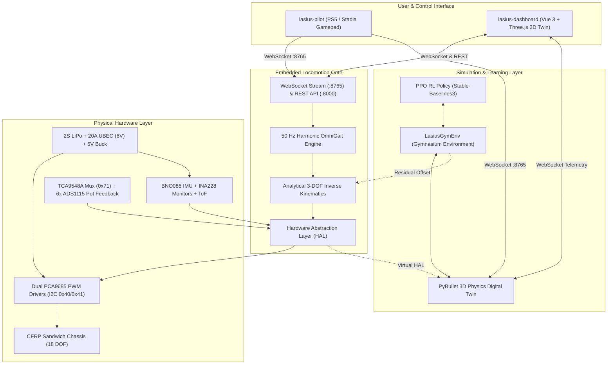
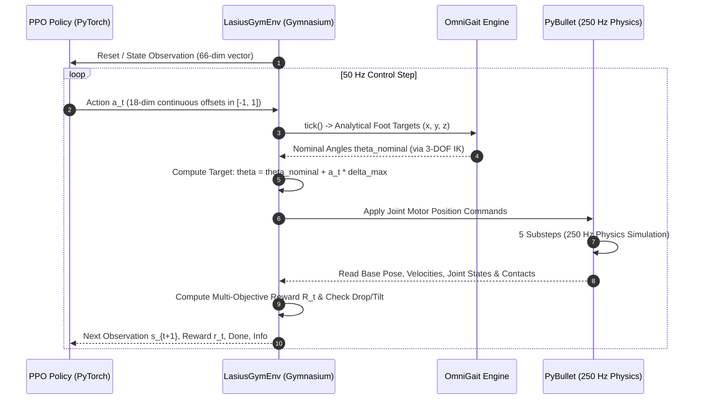

# Lasius Hexapod: System & Domain Architecture

---

[Index](../README.md) | [Software](../software/README.md) | [Hardware](../hardware/README.md) | [Docs](README.md) | [Data](../data/README.md) | [Scripts](../scripts/README.md) |<br>
[Domain Overview](#1-system-overview--domain-boundaries) | [Mechanics](#2-domain-1-mechanics--hardware-as-code) | [Electronics](#3-domain-2-electronics--power-distribution) | [Motion Control](#4-domain-3-embedded-software--locomotion) | [Simulation & RL](#6-domain-5-physics-simulation--reinforcement-learning) |

---

Comprehensive domain and system architecture specification for the **Lasius** 18-DOF biomimetic hexapod walking robot.



---

## 1. System Overview & Domain Boundaries

The Lasius architecture partitions the autonomous walking robot into **6 cohesive engineering domains**:

| Domain | Scope & Responsibilities | Core Technologies | Key Repository Locations |
| :--- | :--- | :--- | :--- |
| **1. Mechanics** | Parametric CAD solids, 18-DOF kinematics geometry, 3D printing tolerances, and structural integrity. | FreeCAD, STEP, STL, DXF, PETG, CFRP | [`hardware/mechanics/`](../hardware/mechanics/) |
| **2. Electronics** | Power distribution, dual logic rail isolation, sensor bus topology, and cable harnesses. | WireViz, PCA9685, I2C, 2S LiPo, UBEC | [`hardware/electronics/`](../hardware/electronics/), [`docs/hardware/`](hardware/) |
| **3. Embedded Core** | 50 Hz harmonic gait generation, analytical inverse kinematics, HAL, REST & WebSocket daemon. | Python 3.11+, asyncio, websockets | [`software/lasius-core/`](../software/lasius-core/) |
| **4. 3D Digital Twin** | Browser-based 3D visualization, standalone client-side simulation, and operator dashboard. | Vue 3, TypeScript, Three.js WebGL | [`software/lasius-dashboard/`](../software/lasius-dashboard/) |
| **5. Teleoperation** | Zero-dependency Linux gamepad driver, radial deadzone filtering, and multi-controller profiles. | Python, Linux Joystick API (`/dev/input/js*`) | [`software/lasius-pilot/`](../software/lasius-pilot/) |
| **6. Physics & RL** | High-fidelity PyBullet/MuJoCo physics, Gymnasium environment, and PPO residual learning. | PyBullet, MuJoCo, Gymnasium, Stable-Baselines3, PyTorch | [`scripts/sim/`](../scripts/sim/), [`software/lasius-core/src/lasius/core/sim/`](../software/lasius-core/src/lasius/core/sim/) |

---

## 2. Domain 1: Mechanics & Hardware-as-Code

The mechanical architecture follows the strict **3-Level Hardware-as-Code Principle**:

1. **Level 1 — Variability (`cots/` vs. `custom/`):**
   * `cots/`: Immutable Commercial Off-The-Shelf components (Hitec HS-645MG / NR-645 servos, ball bearings, DIN 912 screws, nylon standoffs).
   * `custom/`: Parametric parts developed and fabricated in-house.
2. **Level 2 — Constructive Generations (`custom/v1/`, `custom/v2/`):**
   * Encapsulates consistent design evolutions (e.g. `v1` = flat carbon plates + 3D printed spacers; `v2` = monolithic printed shell).
3. **Level 3 — System Entry Point vs. Component:**
   * Assemblies (`body_assembly.FCStd`, `leg_assembly.FCStd`) sit at the generation root (`custom/v1/`).
   * Individual parts (`coxa_bracket.FCStd`, `femur.FCStd`, `tibia.FCStd`) are encapsulated in `custom/v1/parts/`.
   * **Canonical Filenames:** Files are named canonically without SemVer suffixes (e.g. `parts/femur.FCStd`) to ensure FreeCAD `App::Link` (`PropertyXLink`) stability across Git revisions.

### Kinematic Leg Dimensions & Standing Stance
* **Coxa Link Length ($L_0$):** $56.5\,\text{mm}$ (distance from vertical yaw axis to horizontal pitch axis).
* **Femur Link Length ($L_1$):** $100.0\,\text{mm}$ (distance between femur pitch axis and knee pitch axis).
* **Tibia Link Length ($L_2$):** $130.0\,\text{mm}$ (distance from knee pitch axis to spherical foot tip).
* **Total Reach:** $286.5\,\text{mm}$ per leg.
* **Femur Lateral Offset:** $Y = \pm 2.50\,\text{mm}$ for symmetrical joint clearance.
* **Calibrated Standing Stance:** Foot ground contact radius $R = 190.0\,\text{mm}$ at chassis height $Z = 161.5\,\text{mm}$ with 12 simultaneous ground contacts.

---

## 3. Domain 2: Electronics & Power Distribution

### Power Architecture
The robot operates on a dual-rail power topology to isolate high-current inductive motor spikes from sensitive microelectronics:

```
[2S LiPo (7.4V - 8.4V)]
       ├──> [20A UBEC Step-Down (6.0V Rail)] ──> 18× High-Torque Servos (Dual PCA9685)
       └──> [5V / 3A DC-DC Buck Converter]  ──> Raspberry Pi 4 B SoC
                                                        │ (3.3V GPIO / I2C)
                                                        └──> TCA9548A Mux, BNO085 IMU, ADS1115
```

### I2C Bus Topology & Addressing

| Device | I2C Bus | Address | Description |
| :--- | :--- | :--- | :--- |
| **PCA9685 Driver 0** | Pi `i2c-1` | `0x40` | Left legs PWM controller (LF, LM, LR — 9 channels used) |
| **PCA9685 Driver 1** | Pi `i2c-1` | `0x41` | Right legs PWM controller (RF, RM, RR — 9 channels used) |
| **PCA9685 All-Call** | Pi `i2c-1` | `0x70` | Global broadcast address for synchronous emergency stop |
| **TCA9548A Multiplexer** | Pi `i2c-1` | `0x71` | 8-Channel sub-bus multiplexer for closed-loop potentiometer ADCs |
| **ADS1115 (Ch 0–5)** | TCA Sub 0–5 | `0x48` | 16-bit 4-channel ADCs reading internal servo potentiometer taps |
| **BNO085 9-DOF IMU** | Pi `i2c-1` | `0x4A` | Robotic heading, quaternion attitude, and gravity vector |
| **INA228 Monitors** | Pi `i2c-1` | `0x45` | Real-time voltage, current (up to 20A), and power telemetry |

---

## 4. Domain 3: Embedded Software & Motion Control

### Analytical 3-DOF Inverse Kinematics
For any Cartesian foot target coordinate $(x, y, z)$ defined in the leg's local coxa frame, the joint angles are determined analytically in closed form without iterative numerical solvers:

$$\alpha = \operatorname{atan2}(y, x)$$
$$r = \sqrt{x^2 + y^2}, \quad d = \sqrt{(r - L_0)^2 + z^2}$$
$$\beta = \arccos\left(\frac{L_1^2 + d^2 - L_2^2}{2 L_1 d}\right) + \operatorname{atan2}(z, r - L_0)$$
$$\gamma = \arccos\left(\frac{L_1^2 + L_2^2 - d^2}{2 L_1 L_2}\right) - \pi$$

### Harmonic Cosine Gait Engine (`OmniGait`)
The gait engine generates smooth, jerk-free trajectories at **50 Hz** using half-cosine velocity profiles:
* **Tripod Gait (Duty Cycle 0.50):** 3 legs swing simultaneously (LF, RM, LR vs. RF, LM, RR). Fast, dynamic, highly efficient on flat terrain.
* **Ripple Gait (Duty Cycle 0.67):** 2 legs swing simultaneously. Exceptional stability for moderate uneven ground.
* **Wave Gait (Duty Cycle 0.83):** 1 leg swings at a time, 5 legs maintain ground contact. Maximum static stability for extreme inclines and obstacle climbing.
* **Omnidirectional Locomotion:** Simultaneous forward/backward translation ($v_x$), lateral strafing ($v_y$), and in-place yaw turning ($\omega_z$).

---

## 5. Domain 4: 3D Digital Twin & Gamepad Teleoperation

### Dual-Engine Digital Twin (`lasius-dashboard`)
Built with Vue 3, TypeScript, and Three.js WebGL:
* **Standalone Browser Mode:** Contains an identical client-side TypeScript kinematics and gait engine, allowing visitors to drive the robot with keyboard or on-screen controls directly in the browser ([live demo](https://dashboard.lasius.kaemmereit.de/)).
* **Live Hardware Mode:** Connects to `ws://<pi-ip>:8765` and renders physical servo telemetry with IMU artificial horizon and power meters.

### Multi-Gamepad Teleoperation (`lasius-pilot`)
* Reads raw binary joystick events directly from `/dev/input/js0` using Linux kernel event structures (zero external C-bindings).
* Applied **radial deadzone filtering** to eliminate stick creep.
* YAML configuration profiles for **Sony PS5 DualSense** (`ps5.yaml`), **Google Stadia** (`stadia.yaml`), and **Xbox** (`xbox.yaml`).

---

## 6. Domain 5: Physics Simulation & Reinforcement Learning



### Gymnasium Environment (`LasiusGymEnv`)
* **Observation Space (66 Dimensions):**
  * Projected gravity vector ($R^T [0, 0, -1]$) — 3 values (gimbal-lock-free orientation).
  * Base linear velocity in robot frame ($R^T v$) — 3 values.
  * Base angular velocity in robot frame ($R^T \omega$) — 3 values.
  * Joint angle deviation from standing posture ($\theta_i - \theta_{stand, i}$) — 18 values.
  * Joint angular velocities ($\dot{\theta}_i$) — 18 values.
  * Velocity commands ($v_x^{cmd}, v_y^{cmd}, \omega_z^{cmd}$) — 3 values.
  * Previous action ($a_{t-1}$) — 18 values (for smoothness regularization).
* **Action Space (18 Dimensions):**
  * Continuous vector in $[-1.0, 1.0]$.
  * **Residual RL Mode:** Adds bounded offsets ($\Delta \theta_i \le \pm 11.5^\circ$) to the analytical gait. Guarantees stability from step 0 while the network learns terrain adaptation and balance.
  * **Direct Joint Mode:** Controls joint angles directly relative to standing stance.
* **Reward Formulation:**
  $$R_t = 1.2 R_{\text{lin}} + 0.6 R_{\text{ang}} + 0.4 R_{\text{upright}} + 0.4 R_{\text{height}} - 0.05 P_{\text{action\_diff}} - 0.001 P_{\text{joint\_vel}}$$
* **Throughput:** ~500 FPS using 4 vectorized parallel environments on standard CPU hardware.

---

## 7. Verification & Tooling Matrix

| Tool | Category | Command | Target Validation |
| :--- | :--- | :--- | :--- |
| **`scripts/dev/run_tests.sh`** | Testing | `./scripts/dev/run_tests.sh` | 66 Unittests across `lasius-core`, `lasius-pilot`, and `gym_env`. |
| **`scripts/dev/check_links.py`** | Quality | `python3 scripts/dev/check_links.py` | 311 Markdown hyperlinks and cross-references. |
| **`scripts/sim/sim_pilot.sh`** | Simulation | `./scripts/sim/sim_pilot.sh` | PyBullet 3D digital twin + PS5 teleoperation orchestration. |
| **`scripts/sim/train_rl.py`** | AI / RL | `python3 scripts/sim/train_rl.py` | PPO locomotion policy training with Stable-Baselines3. |
| **`scripts/sim/eval_rl.py`** | AI / RL | `python3 scripts/sim/eval_rl.py` | 3D PyBullet policy evaluation and real-time telemetry. |
| **`scripts/deploy/deploy_pi.sh`** | Deployment | `./scripts/deploy/deploy_pi.sh [PI_IP]` | Automated rsync deployment and systemd daemon reload on Raspberry Pi. |
