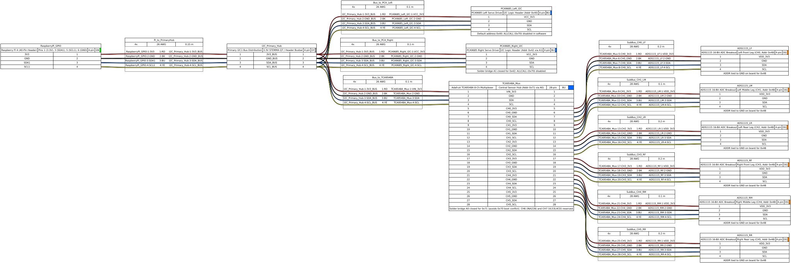
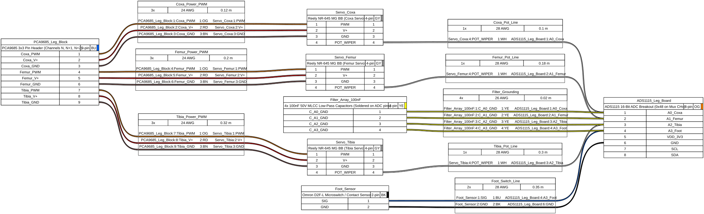
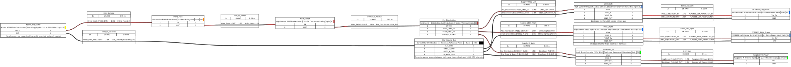

# Hexapod:Lasius – 18-DOF Closed-Loop Potentiometer Feedback
## Hardware Specification, Connection Plan & Architectural Findings

> **Project:** Hexapod:Lasius (18 DOF, 6 Legs)  
> **Status:** Verified & Specified  
> **Date:** November 2026  
> **Architecture:** 100% Python on Raspberry Pi 4 (I2C Multiplexing via TCA9548A + 6× ADS1115)

---

## 1. Executive Summary & Architectural Decisions

To achieve full 18-DOF real-time joint angle feedback (position telemetry, stall detection, torque estimation, and tactile foot contact sensing), the wiper voltage of the internal feedback potentiometers is tapped across all 18 **Reely NR-645 MG BB** servos.

### Architectural Rationale & Trade-Offs:
1. **No External Microcontroller / Flashing (Against Co-Processor / Pico solutions):**  
   A dedicated co-processor (RP2040 / Raspberry Pi Pico) would introduce a "two-brain problem": fragmented toolchains, manual `BOOTSEL` flashing, loss of seamless SSH deployment via `./scripts/deploy/deploy_pi.sh`, and RF noise from the Pico W near analog lines.
2. **Pure Single-Source-of-Truth in Python on Raspberry Pi 4:**  
   All sensor processing runs natively inside `lasius-core` under Linux. Fully simulated in tests via `pytest` (`MockADC`), tracked in Git, and deployable atomically.
3. **1:1 Leg Symmetry (1 Board = 1 Leg):**  
   With a **6-pack of ADS1115 boards**, each of the 6 legs receives a dedicated 4-channel ADC board at the leg mount point, avoiding cross-torso analog routing.
4. **TCA9548A 8-Channel Multiplexer as Master Hub:**  
   Decouples all 6 ADS1115 boards onto isolated I2C sub-busses. All 6 boards run conflict-free on their default address `0x48`.
5. **Cost Efficiency:**  
   Total electronics cost for 18 channels: **€17.98** (6× ADS1115 for €12.99 + 2× TCA9548A for €4.99).

---

## 2. Experimental Characteristics & Calibration (Reely NR-645 MG BB)

On the test bench (Channel 15 on PCA9685 Board 1 `0x40`), the characteristic curve of the internal potentiometer was empirically measured using the interactive calibration wizard ([`scripts/bench/pot_calibration_wizard.py`](../../scripts/bench/pot_calibration_wizard.py)):

```text
       Characteristic Curve: Reely NR-645 MG BB Potentiometer
Voltage [V]
  2.10 ┤                                           ╭── +60° (2.02V)
  1.90 ┤                                     ╭─────╯
  1.70 ┤                               ╭─────╯
  1.50 ┤ ─────────── 0° (1.563V) ──────╯  [1500 µs Neutral]
  1.30 ┤                         ╭─────╯
  1.10 ┤                   ╭─────╯
  0.90 ┤ ── -60° (1.11V) ──╯
       └─┬───────┬───────┬───────┬───────┬───────┬───────┬── Joint Angle [°]
       -60°    -45°    -30°    -15°      0°     +15°    +30°    +60°
```

### Verified Model Parameters:
- **Linearity ($R^2$):** **0.99959** (99.96% linearity — practically ideal)
- **Sensitivity (Slope $m$):** **$+7.589\,\text{mV}/^\circ$** ($0.007589\,\text{V}/^\circ$)
- **Scale Factor ($k$):** **$131.772^\circ/\text{V}$**
- **Zero-Point Voltage ($V_{0^\circ}$):** **$1.5633\,\text{V}$** at $0.0^\circ$ (1500 µs neutral pulse)
- **Max Linearity Deviation:** only **$\pm 1.45^\circ$** (or $\pm 11.0\,\text{mV}$)
- **Full-Scale Voltage Range ($\pm 90^\circ$):** $\sim 0.88\,\text{V}$ to $\sim 2.25\,\text{V}$  
  *(Safely within the 3.3V operating limit of the Raspberry Pi / ADS1115).*

### Mathematical Closed-Loop Transformation Formulas:
$$\theta(V) = (V_{\text{measured}} - 1.5633\,\text{V}) \cdot 131.772^\circ$$
$$V_{\text{target}}(\theta) = 1.5633\,\text{V} + (\theta \cdot 0.007589\,\text{V}/^\circ)$$

---

## 3. Circuit Topology (Full System: Actuation & Sensing)

The diagram below illustrates the strict separation and interaction between the **PWM Actuation Branch** (PCA9685, 5–6V high-current load) and the **ADC Sensing Branch** (TCA9548A, 3.3V logic):

```mermaid
flowchart TD
    subgraph Power["Power Supply"]
        UBEC["Bench Supply / UBECs 5.0V - 6.0V Servo Load"]
        PiPower["5V / 3A Logic Supply Raspberry Pi 4"]
        CommonGND["=== Common Star-GND Ground Bus ==="]
    end

    subgraph Pi["Raspberry Pi 4 (Core / lasius-core)"]
        I2C_Main["Primary I2C Bus 1: SDA Pin 3, SCL Pin 5"]
        Rail3V3["Logic 3.3V Pin 1"]
        PiGND["GND Pin 6"]
    end

    subgraph PWM_Actuation["Actuation Branch (Primary I2C Bus)"]
        PCA1["PCA9685 Left 0x40 - 9 PWM Channels LF, LM, LR"]
        PCA2["PCA9685 Right 0x42 - 9 PWM Channels RF, RM, RR"]
    end

    subgraph Sensor_Hub["Sensing Branch (TCA9548A Hub on 0x71)"]
        TCA["TCA9548A 8-Channel Multiplexer 0x71 via A0 Jumper"]
        ADS_LF["CH0: ADS1115 LF 0x48 - Coxa, Femur, Tibia, Foot"]
        ADS_LM["CH1: ADS1115 LM 0x48 - Coxa, Femur, Tibia, Foot"]
        ADS_LR["CH2: ADS1115 LR 0x48 - Coxa, Femur, Tibia, Foot"]
        ADS_RF["CH3: ADS1115 RF 0x48 - Coxa, Femur, Tibia, Foot"]
        ADS_RM["CH4: ADS1115 RM 0x48 - Coxa, Femur, Tibia, Foot"]
        ADS_RR["CH5: ADS1115 RR 0x48 - Coxa, Femur, Tibia, Foot"]
        INA["CH6: 2x INA228 Power Monitors"]
        ToF["CH7: VL53L4CD ToF Distance Sensor"]
    end

    subgraph Servos_Physical["18x Reely NR-645 MG BB Servos"]
        Servos_L["9x Servos Left Body Half LF, LM, LR"]
        Servos_R["9x Servos Right Body Half RF, RM, RR"]
    end

    %% Main I2C Bus
    I2C_Main ===|Primary Bus| PCA1
    I2C_Main ===|Primary Bus| PCA2
    I2C_Main ===|Primary Bus| TCA

    %% Multiplexer Sub-Channels
    TCA -->|Sub-I2C 0| ADS_LF
    TCA -->|Sub-I2C 1| ADS_LM
    TCA -->|Sub-I2C 2| ADS_LR
    TCA -->|Sub-I2C 3| ADS_RF
    TCA -->|Sub-I2C 4| ADS_RM
    TCA -->|Sub-I2C 5| ADS_RR
    TCA -->|Sub-I2C 6| INA
    TCA -->|Sub-I2C 7| ToF

    %% PWM Signals
    PCA1 -->|9x PWM Signals| Servos_L
    PCA2 -->|9x PWM Signals| Servos_R

    %% Potentiometer Feedback
    Servos_L -.->|Potentiometer Signals with 100nF Filter| ADS_LF
    Servos_L -.-> ADS_LM
    Servos_L -.-> ADS_LR

    Servos_R -.->|Potentiometer Signals with 100nF Filter| ADS_RF
    Servos_R -.-> ADS_RM
    Servos_R -.-> ADS_RR

    %% Common Ground
    UBEC -.-> CommonGND
    PiGND -.-> CommonGND
    PCA1 -.-> CommonGND
    PCA2 -.-> CommonGND
    TCA -.-> CommonGND
```



<p align="center">
  
</p>

---

## 4. Detailed Wiring and Connection Plan

### 4.1 Multiplexer TCA9548A (Central Hub)
- **Power:** `VIN` to **3.3V** (Pi Pin 1), `GND` to **GND** (Pi Pin 6).
- **Control Bus to Pi:** `SDA` to **GPIO 2** (Pi Pin 3), `SCL` to **GPIO 3** (Pi Pin 5).
- **Reset Pin (`RST`):** Leave **floating** (internal 10k pull-up active).
- **CRITICAL SOLDER JUMPER (`A0`):**  
  > [!IMPORTANT]
  > On the TCA9548A breakout, the **solder jumper `A0` must be bridged** (solder blob across both pads).  
  > **Reason:** The PCA9685 servo driver boots with active `ALLCALL` address `0x70`. By setting `A0=High`, the TCA9548A operates permanently at **`0x71`**, eliminating address conflicts at power-on.

### 4.2 The 6 Leg Modules (ADS1115)
All 6 ADS1115 boards are wired identically. The address line `ADDR` is connected to `GND` on each board (**Standard address `0x48`** on each isolated Mux channel):

| ADS1115 Pin | Connection on TCA9548A Sub-Channel | Function |
| :--- | :--- | :--- |
| **VDD** | Shared **3.3V** Rail (Raspberry Pi) | Logic power supply |
| **GND** | Shared **GND** Rail (Common Ground) | Ground reference |
| **SCL** | **`SCn`** on TCA9548A (e.g. `SC0` for LF) | Isolated sub-I2C clock |
| **SDA** | **`SDn`** on TCA9548A (e.g. `SD0` for LF) | Isolated sub-I2C data |
| **ADDR** | Board **GND** | Fixes address to `0x48` |
| **ALRT** | *(Leave floating)* | Not used |
| **A0** | **Coxa Servo Potentiometer Line** | Hip swing joint angle |
| **A1** | **Femur Servo Potentiometer Line** | Thigh joint angle |
| **A2** | **Tibia Servo Potentiometer Line** | Knee / claw joint angle |
| **A3** | **Foot Contact Sensor** *(or reserve)* | Ground touchdown detection |

---

## 5. Low-Pass Filter Placement (100 nF Ceramic Capacitors)

To eliminate motor brush and PWM switching noise, **monolithic ceramic capacitors (MLCC, 100 nF, 50V, code `104`)** are installed directly at the ADC inputs:

```text
              ADS1115 Breakout (Bottom PCB Side)
          ┌─────────────────────────────────────────┐
          │  [VDD]   [GND]   [SCL]   [SDA]   [ADDR] │
          │            │                            │
          │            ├───┐       ┌───────┐        │
          │            │ [100nF] [100nF] [100nF]    │
          │            │   │       │       │        │
          │  [ALRT]    └───┼───────┼───────┼──────┐ │
          │                │       │       │      │ │
          │              [A0]    [A1]    [A2]   [A3]│
          │              Coxa    Femur   Tibia  Foot│
          └─────────────────────────────────────────┘
```

> [!TIP]
> **No Separate Filter PCB Required:**  
> The 3 capacitors are soldered **directly across the underside of the pin header** on each ADS1115 between `A0/GND`, `A1/GND`, and `A2/GND`.  
> This eliminates 18 intermediate jumper wires, occupies 0 mm of additional chassis space, and provides optimal filtering right at the measurement pins.

<p align="center">
  
</p>

<p align="center">
  
</p>

---

## 6. Software Driver Implementation in Python

Using the Adafruit CircuitPython library stack, the telemetry driver integrates directly into the `lasius-core` daemon on the Raspberry Pi 4:

### 6.1 Package Requirements
```bash
pip install adafruit-circuitpython-tca9548a adafruit-circuitpython-ads1x15
```

### 6.2 Python Driver Architecture (`lasius.core.hardware.adc`):

```python
"""
Lasius 18-DOF Closed-Loop ADC Telemetry Driver.
Maps 6 legs across 6 TCA9548A channels to 6 ADS1115 boards.
"""
import board
import adafruit_tca9548a
import adafruit_ads1x15.ads1115 as ADS
from adafruit_ads1x15.analog_in import AnalogIn

class HexapodTelemetryADC:
    # Empirically calibrated parameters (Reely NR-645 MG BB)
    V_INTERCEPT = 1.5633    # Volts at 0.0°
    DEG_PER_VOLT = 131.772  # Degrees per Volt

    LEG_MUX_CHANNELS = {
        "left_front":   0,
        "left_middle":  1,
        "left_rear":    2,
        "right_front":  3,
        "right_middle": 4,
        "right_rear":   5,
    }

    def __init__(self, mux_address: int = 0x71):
        self.i2c = board.I2C()
        self.tca = adafruit_tca9548a.TCA9548A(self.i2c, address=mux_address)
        self.adcs = {}
        self.inputs = {}

        for leg_name, ch in self.LEG_MUX_CHANNELS.items():
            # Initialize ADS1115 on isolated multiplexer sub-bus
            adc = ADS.ADS1115(self.tca[ch], address=0x48)
            adc.data_rate = 860  # Maximum sampling rate
            self.adcs[leg_name] = adc
            self.inputs[leg_name] = {
                "coxa":  AnalogIn(adc, ADS.P0),
                "femur": AnalogIn(adc, ADS.P1),
                "tibia": AnalogIn(adc, ADS.P2),
                "foot":  AnalogIn(adc, ADS.P3),
            }

    def read_joint_angle(self, leg_name: str, joint: str) -> float:
        """Returns the physical joint angle in degrees."""
        voltage = self.inputs[leg_name][joint].voltage
        angle_deg = (voltage - self.V_INTERCEPT) * self.DEG_PER_VOLT
        return round(angle_deg, 2)

    def read_leg_angles(self, leg_name: str) -> dict:
        """Reads all 3 joint angles of a leg."""
        return {
            "coxa":  self.read_joint_angle(leg_name, "coxa"),
            "femur": self.read_joint_angle(leg_name, "femur"),
            "tibia": self.read_joint_angle(leg_name, "tibia"),
        }
```

---

## 7. Safety Rules & Best Practices

1. **Common Star-Ground:**  
   The servo power ground (bench power supply / UBECs) and Raspberry Pi ground (Pin 6) **must be bonded via a low-resistance ground wire**. This ensures potentiometers and ADCs share an identical reference voltage.
2. **Strict 3.3V Logic Separation:**  
   The ADS1115 and TCA9548A boards must be powered **exclusively from 3.3V** (Pi Pin 1). Never connect them to 5V, as this would expose the Raspberry Pi I2C pins to over-voltage damage.
3. **Wire Routing & Shielding:**  
   Use 4-pin connectors (e.g. JST-ZH or DuPont) for each leg lead. Never route the analog potentiometer wiper wires directly parallel to high-current UBEC power leads; always route them alongside the servo ground lead for shielding.
