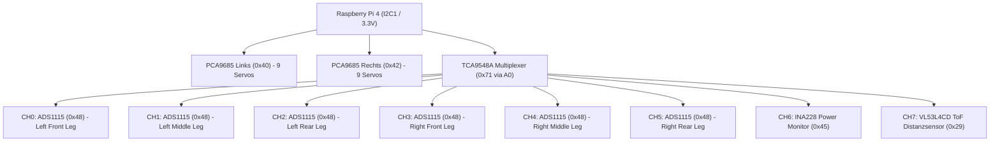

# Lasius Hexapod: Elektronik-Testbench & I2C-Sensorbus Leitfaden

*Systematischer Bring-Up-Leitfaden für die Inbetriebnahme des multiplexierten I2C-Sensorbusses (TCA9548A + ADS1115 ADCs) am Raspberry Pi 4.*

---

## 1. Übersicht & Architektur

Für die Closed-Loop-Gelenkwinkelrückführung und Fußsensorik nutzt der Lasius Hexapod eine zweistufige I2C-Architektur:
* **Aktoren (PWM-Servos):** Zwei PCA9685 Treiberboards (`0x40` links, `0x42` rechts) direkt am primären I2C-Bus 1 des Raspberry Pi 4.
* **Sensorik (ADCs & Telemetrie):** Ein zentraler **TCA9548A 8-Kanal-I2C-Multiplexer** trennt die 6 Bein-ADCs (**ADS1115**, 16-Bit), sodass alle ADCs dieselbe Standardadresse `0x48` nutzen können, ohne Adresskonflikte zu verursachen.



---

## 2. Sicherheitsregeln & Spannungspegel

> [!CAUTION]
> **Strikt 3.3V Logikspannung:** Der Raspberry Pi 4 besitzt **keine 5V-toleranten GPIOs**.
> * Alle I2C-Komponenten (TCA9548A, ADS1115) müssen zwingend über **Pin 1 (3.3V)** des Raspberry Pi versorgt werden.
> * Niemals 5V an `VCC`, `SDA` oder `SCL` der Sensorik anlegen.

> [!IMPORTANT]
> **Vermeidung des 0x70 All-Call-Adresskonflikts:**
> Standardmäßig startet der TCA9548A auf Adresse `0x70`. In den PCA9685 PWM-Treibern ist `0x70` jedoch hardwaremäßig als *All-Call-Adresse* reserviert (Broadcast an alle Servotreiber).
> * **Lösung:** Schließe die Lötbrücke **`A0`** auf dem TCA9548A-Breakout (oder verbinde Pin `A0` mit 3.3V).
> * Dies verschiebt die Multiplexer-Adresse auf **`0x71`** und garantiert einen konfliktfreien Betrieb.

---

## 3. Verdrahtungstabelle (Testbench-Aufbau)

### 3.1 Verbindung: Raspberry Pi 4 $\leftrightarrow$ TCA9548A Multiplexer
| Raspberry Pi 4 Pin | Signal | TCA9548A Pin | Funktion |
|---|---|---|---|
| **Pin 1** | 3.3V DC | `VIN` / `VCC` | Logikversorgung |
| **Pin 6, 9 oder 14** | GND | `GND` | Gemeinsame Masse |
| **Pin 3 (GPIO 2)** | I2C1 SDA | `SDA` | I2C Datenleitung |
| **Pin 5 (GPIO 3)** | I2C1 SCL | `SCL` | I2C Taktleitung |
| *(Interne Brücke)* | 3.3V DC | `A0` | Adress-Offset $\to$ Basisadresse `0x71` |
| *(Offen / GND)* | GND | `A1`, `A2` | Unbeschaltet (Logisch 0) |

### 3.2 Verbindung: TCA9548A (Kanal 0) $\leftrightarrow$ ADS1115 ADC
| TCA9548A Pin | Signal | ADS1115 Pin | Funktion |
|---|---|---|---|
| `3.3V` (vom Pi) | 3.3V DC | `VDD` | Logik- und Referenzspannung |
| `GND` (vom Pi) | GND | `GND` | Masse |
| **`SD0`** | Sub-Bus 0 SDA | `SDA` | I2C Daten Sub-Kanal 0 |
| **`SC0`** | Sub-Bus 0 SCL | `SCL` | I2C Takt Sub-Kanal 0 |
| `GND` | GND | `ADDR` | Wählt Standardadresse `0x48` |
| *(Testspannung)* | 0.0 .. 3.3V | `A0` | Analogeingang Kanal 0 (z. B. Poti) |

---

## 4. Der 6-Schritte-Inbetriebnahmeprozess

### Schritt 1: Vorbereitung & Adressprüfung
1. Lötbrücke `A0` am TCA9548A prüfen bzw. schließen (Adresse `0x71`).
2. Sicherstellen, dass der Pi heruntergefahren ist, bevor Jumperkabel gesteckt werden.
3. Verifikation im Skript:
   ```bash
   python3 scripts/bench/test_electronics.py --step 1
   ```

### Schritt 2: TCA9548A mit dem Pi verbinden
1. Stecke die 4 Leitungen: 3.3V (Pin 1), GND (Pin 6), SDA (Pin 3), SCL (Pin 5).
2. Raspberry Pi booten.
3. Verifikation im Skript:
   ```bash
   python3 scripts/bench/test_electronics.py --step 2
   ```

### Schritt 3: I2C-Erkennung des Multiplexers prüfen
1. Scan auf dem Raspberry Pi ausführen:
   ```bash
   i2cdetect -y 1
   ```
2. Erwartetes Ergebnis: In Zeile `70:` erscheint `71`.
3. Verifikation mit dem Lasius-Testtool:
   ```bash
   python3 scripts/bench/test_electronics.py --step 3
   ```

### Schritt 4: ADS1115 an Sub-Kanal 0 anbinden
1. Verdrahte VDD, GND, SD0 $\to$ SDA, SC0 $\to$ SCL.
2. Verbinde ADDR des ADS1115 mit GND (festigt `0x48`).
3. Verifikation im Skript:
   ```bash
   python3 scripts/bench/test_electronics.py --step 4
   ```

### Schritt 5: Sub-Bus-Umschaltung & ADC-Erkennung verifizieren
1. Der Multiplexer schaltet Kanal 0 aktiv und scannt den Sub-Bus:
   ```bash
   python3 scripts/bench/test_electronics.py --step 5
   ```
2. Erwartetes Ergebnis: `✔ ERFOLG: ADS1115 erkannt auf Sub-Kanal 0 (Adresse 0x48)!`.

### Schritt 6: Analoge Spannungsmessung an A0
1. Schließe ein Potentiometer oder einen Spannungsteiler an `A0` an (Schleifer an A0, äußere Pins an 3.3V und GND).
2. Einzelmessung durchführen:
   ```bash
   python3 scripts/bench/test_electronics.py --step 6
   ```
3. Live-Monitor starten:
   ```bash
   python3 scripts/bench/test_electronics.py --channel 0 --read-analog 0
   ```
   *Drehe am Potentiometer: Der Spannungswert muss stufenlos von 0.000 V bis 3.300 V wandern.*

---

## 5. Vollständiger System-Scan

Sobald mehrere Beine oder Sensoren angeschlossen sind, scannt das Tool die gesamte Bus-Hierarchie in einem Durchlauf:

```bash
# Auf dem Raspberry Pi:
python3 scripts/bench/test_electronics.py --scan

# Auf dem Entwicklungs-Laptop (Offline-Simulation):
python3 scripts/bench/test_electronics.py --scan --mock
```

---

## 6. Troubleshooting & Häufige Fehler

| Symptom | Mögliche Ursache | Abhilfe |
|---|---|---|
| `i2cdetect` zeigt leere Tabelle | I2C im Kernel deaktiviert | `sudo raspi-config` $\to$ Interface Options $\to$ I2C aktivieren, Reboot. |
| Permission denied auf `/dev/i2c-1` | Fehlende Benutzergruppe | `sudo usermod -aG i2c $USER`, neu einloggen. |
| TCA9548A erscheint auf `0x70` statt `0x71` | `A0` unbeschaltet | Brücke `A0` schließen oder Pin `A0` mit 3.3V verbinden. |
| ADS1115 auf CH0 wird nicht erkannt | `ADDR` floatet | `ADDR`-Pin fest mit Masse (`GND`) verbinden. |
| ADC liest konstant 0V oder 3.3V | Schleifer offen / falscher Pin | Prüfe Verbindung von `A0` mit Multimeter gegen GND. |
