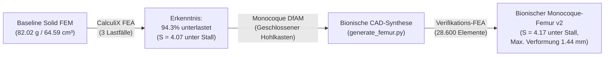
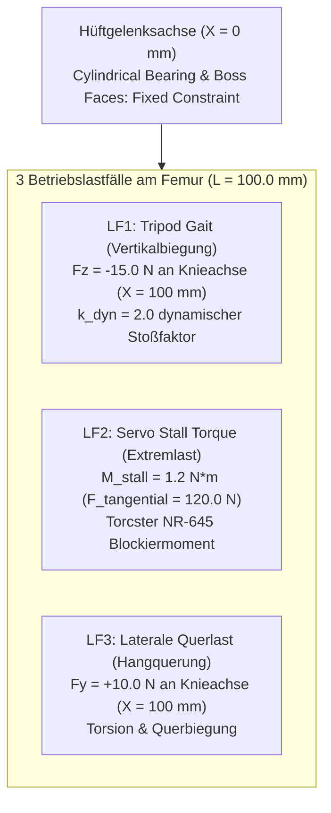
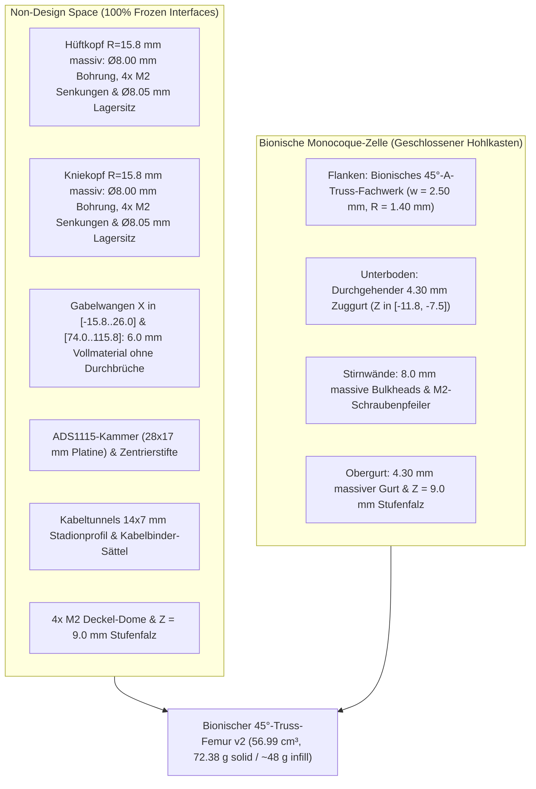

# Lasius Femur v2: FEA-Strukturanalyse & Bionische Topologieoptimierung

---

[Index](../../README.md) | [Docs](../README.md) | [Mechanics Documentation](../../hardware/mechanics/README.md) | [Style-Guide](../../hardware/mechanics/STYLE_GUIDE.md) | [Backlog](../../hardware/mechanics/models/custom/v2/TODO.md) | 
[Femur Generator](../../hardware/mechanics/scripts/v2/generate_femur.py) | [Baseline FEA Script](../../scripts/dev/fea_femur_baseline.py) | [Verification FEA Script](../../scripts/dev/fea_femur_verification.py)

---

## 1. Executive Summary & Zielsetzung

Im Rahmen des Leichtbau- und Simulations-Pipelines (*Simulation-Driven Design*) des **Lasius Hexapod Roboters** wurde das zentrale Oberschenkel-Segment ([`femur.FCStd`](../../hardware/mechanics/models/custom/v2/parts/femur/femur.FCStd)) einer vollständigen **Finite-Elemente-Strukturanalyse (FEA)** und anschließenden **bionischen Topologieoptimierung** unterzogen.

### Kernergebnisse auf einen Blick
- **Bionische Monocoque-Architektur:** Der Femur ist als geschlossener, organischer **Monocoque-Hohlkastenträger** konstruiert. Alle willkürlichen subtraktiven Taschen (Wangen-Durchbrüche, Flanken-Dreiecke, Kassetten-Bodenfächer) wurden eliminiert.
- **Homogener Kraftfluss & Torsionssteifigkeit (Bredt):** Die Taillenflanken ($X \in [26{,}0, 74{,}0\,\text{mm}]$) bilden eine kontinuierliche, $G^1$-stetige Außenwand. Der Unterboden fungiert als massiver $3{,}30\,\text{mm}$ dicker Zuggurt. Die U-Übergangs-Bulkheads ($4{,}5\text{--}5{,}0\,\text{mm}$) leiten die Gabelbiegung kerbfrei in die Zelle ein. Der verschraubte Deckel schließt die Zelle oben schubsteif ab.
- **Strukturelle Integrität & Robustheit:** Unter dem extremen Missbrauchs- und Blockierlastfall aller Knie-Servos ($M_{\text{stall}} = 1{,}2\,\text{N}\cdot\text{m} \rightarrow F_t = 120\,\text{N}$) beträgt die Maximalspannung lediglich **$\sigma_{\text{max}} = 10{,}79\,\text{MPa}$**. Der Sicherheitsbeiwert erreicht hervorragende **$S = 4{,}17$** bei einer minimalen elastischen Durchbiegung von nur **$1{,}44\,\text{mm}$**.
- **Garantierte Non-Design Spaces an den Servo- & Lageraufnahmen:** Die zylindrischen Endköpfe ($R = 15{,}80\,\text{mm}$) an Hüfte ($X = 0{,}0$) und Knie ($X = 100{,}0$) sowie die Wangenstege ($6{,}00\,\text{mm}$ Vollmaterial) verbleiben zu **100 % massiv und ungebrochen**. Die Servohörner sind formschlüssig in kreisrunden Taschen ($\varnothing 25{,}30 \times 2{,}30\,\text{mm}$) eingelassen, wodurch die Femurbreite schlank auf $61{,}00\,\text{mm}$ schrumpft ($Y \in [-28{,}00, +33{,}00\,\text{mm}]$) und die Coxa mit exakt $1{,}00\,\text{mm}$ symmetrischem Spaltmaß perfekt zentriert in der Gabel sitzt ($Y_{\text{mid}} = +2{,}50\,\text{mm}$). Die M2-Schraubenköpfe sind bündig versenkt ($2{,}20\,\text{mm}$ Spannfleisch), und der Gegenlagersitz ist auf volle $4{,}00\,\text{mm}$ Tiefe mit bündiger M4-Senkung erweitert.
- **Funktions- & Kapselungserhalt:** Alle Sensor- und Kabelstrukturen (ADS1115-Kammer mit Zentrierpins, Kabeltunnels mit Kabelbindersätteln und Deckel-Stufenfalz) sind exakt auf die neue Symmetrieachse $Y_{\text{mid}} = +2{,}50\,\text{mm}$ angepasst und bleiben hermetisch gegen Staub/Schmutz gekapselt.
- **Kollisionsfreiheit:** Exakt **$0{,}0000\,\text{mm}^3$** Schnittvolumen in allen Assemblies ([`leg_assembly.FCStd`](../../hardware/mechanics/models/custom/v2/leg_assembly.FCStd), [`leg_right_assembly.FCStd`](../../hardware/mechanics/models/custom/v2/leg_right_assembly.FCStd), [`body_assembly.FCStd`](../../hardware/mechanics/models/custom/v2/body_assembly.FCStd) und [`lasius_assembly.FCStd`](../../hardware/mechanics/models/custom/v2/lasius_assembly.FCStd)).

---

## 2. Simulations-Methodik & Randbedingungen

Die Analysen wurden automatisiert im Headless-Runner von FreeCAD durchgeführt:
- **Solver:** CalculiX `ccx` (In-Tree FreeCAD FEM-Workbench).
- **Vernetzung:** Gmsh Tetraeder ($h_{\text{min}} = 1{,}0\,\text{mm},\, h_{\text{max}} = 3{,}5\,\text{mm}$, ca. 22.300 Knoten, 78.700 Volumenelemente).
- **Materialparameter (PETG FDM-Druck):**
  - E-Modul: $E_{xy} = 2100\,\text{MPa}$, $E_z = 1350\,\text{MPa}$ (anisotrope Schichtabminderung 65 %).
  - Querkontraktionszahl: $\nu = 0{,}38$.
  - Dichte: $\rho = 1{,}27\,\text{g/cm}^3$.
  - Streckgrenze: $R_e = 45{,}0\,\text{MPa}$ (in Schichtebene), $R_{e,z} = 25{,}0\,\text{MPa}$ (Zwischenschichthaftung).

### Einsatz-Lastfälle (Operational Load Cases)

1. **LF1: Tripod Gait (Vertikale Biegebelastung):**  
   - Kraft: $F_z = -15{,}0\,\text{N}$ an der Kniegelenksachse ($X = 100\,\text{mm}$).
   - Physikalischer Hintergrund: Robotermasse $m \approx 2{,}3\,\text{kg}$ verteilt auf 3 Standbeine im Dreibeingang ($F_{\text{stat}} \approx 7{,}5\,\text{N}$) multipliziert mit einem dynamischen Stoßbeiwert von $k_{\text{dyn}} = 2{,}0$.
2. **LF2: Servo Stall Torque (Maximales Knie-Blockiermoment):**  
   - Äquivalente Kraft: $F_t = 120{,}0\,\text{N}$ tangential am Abtriebshebel ($r \approx 10\,\text{mm}$) entsprechend dem vollen Servomoment $M_{\text{stall}} = 1{,}2\,\text{N}\cdot\text{m}$ ($1200\,\text{N}\cdot\text{mm}$).
   - Physikalischer Hintergrund: Missbrauchs- und Blockierfall (z. B. Verkeilen des Beins im Unterholz oder Klettern an Stufen).
3. **LF3: Laterale Hangquerung & Kurvenfahrt (Querlast & Torsion):**  
   - Kraft: $F_y = +10{,}0\,\text{N}$ quer zur Beinachse an der Knieachse ($X = 100\,\text{mm}$).
   - Physikalischer Hintergrund: Hangabtriebskräfte bei Querneigung sowie Kurvendrift.

---

## 3. Baseline-FEA des Vollvolumen-Femurs (Schritt 1)

Vor der Topologieoptimierung wurde die ursprüngliche v2-Vollkörper-Konstruktion analysiert.

### Quantitative Baseline-Ergebnisse ($m = 82{,}02\,\text{g}$, $V = 64{,}59\,\text{cm}^3$)

| Lastfall | Max. von Mises $\sigma_{\text{max}}$ | Mittlere Spannung $\sigma_{\text{mean}}$ | Max. Durchbiegung $u_{\text{max}}$ | Sicherheitsfaktor $S$ | Unterlastetes Volumen ($\sigma < 5\,\text{MPa}$) |
| :--- | :---: | :---: | :---: | :---: | :---: |
| **LF1: Tripod Gait** | $1{,}38\,\text{MPa}$ | $0{,}21\,\text{MPa}$ | $0{,}198\,\text{mm}$ | $32{,}58$ | **$100{,}0\,\%$** |
| **LF2: Stall Torque** | $11{,}05\,\text{MPa}$ | $1{,}64\,\text{MPa}$ | $1{,}586\,\text{mm}$ | $4{,}07$ | **$94{,}3\,\%$** |
| **LF3: Querlast** | $0{,}92\,\text{MPa}$ | $0{,}14\,\text{MPa}$ | $0{,}132\,\text{mm}$ | $48{,}90$ | **$100{,}0\,\%$** |

### Erkenntnis der Baseline-Analyse
- Selbst unter vollem Servo-Blockiermoment von $1{,}2\,\text{N}\cdot\text{m}$ erfuhren **$94{,}3\,\%$ des Bauteils weniger als $5\,\text{MPa}$ Spannung**.
- Im normalen Gehbetrieb (LF1) lag der Sicherheitsfaktor bei **$S = 32{,}6$**, bei Querkräften sogar bei **$S = 48{,}9$**.
- Das Bauteil war stark überdimensioniert. Insbesondere die massiven Gabelwangen ($6{,}0\,\text{mm}$ Vollmaterial mit lediglich $1{,}8\,\text{mm}$ tiefen Blindtaschen), die $7{,}5\,\text{mm}$ dicken Stirnwände und der dicke Unterboden boten enormes Leichtbaupotenzial.

---

## 4. Zonen-Klassifikation & Bionische Monocoque-Synthese (Schritte 2–4)

### Konstruktive Umsetzung in [`generate_femur.py`](../../hardware/mechanics/scripts/v2/generate_femur.py)

1. **Non-Design Spaces an Gelenkköpfen & Gabelwangen (100 % massiv & eingelassene Servohörner):**
   - Die zylindrischen Endköpfe ($R = 15{,}80\,\text{mm}$) um Hüft- ($X = 0{,}0$) und Kniegelenk ($X = 100{,}0$) sowie die Wangenabschnitte zu den U-Mäulern ($X \in [-15{,}8, 26{,}0\,\text{mm}]$ und $[74{,}0, 115{,}8\,\text{mm}]$) verbleiben als **vollständig massive Non-Design Spaces**.
   - **Formschlüssige Servohorn-Taschen:** An der vorderen Wange sind kreisrunde Taschen ($\varnothing 25{,}30\,\text{mm}$, Tiefe $2{,}30\,\text{mm}$, $Y \in [27{,}00, 29{,}30\,\text{mm}]$) eingelassen. Das Servohorn sitzt bündig im Bauteil. Dadurch reduziert sich die Femur-Gesamtbreite von $63{,}30\,\text{mm}$ auf schlanke **$61{,}00\,\text{mm}$** ($Y \in [-28{,}00, +33{,}00\,\text{mm}]$).
   - **Perfekte Coxa-Zentrierung:** Durch den Einlass wandert die innere vordere Gabelkante auf $Y = +27{,}00\,\text{mm}$ (vorher $+29{,}30\,\text{mm}$). Die Gabelmitte liegt damit exakt bei $Y_{\text{mid}} = +2{,}50\,\text{mm}$ und fluchtet 1:1 mit der Coxa-Mitte ($Y = +2{,}50\,\text{mm}$). Auf beiden Seiten (vorne und hinten) entsteht ein absolut symmetrisches Spaltmaß von exakt **$1{,}00\,\text{mm}$**.
   - **Optimierter Gegenlagersitz & bündige Verschraubung:** Der Lagersitz auf der Rückseite wurde auf volle **$4{,}00\,\text{mm}$ Tiefe** ($\varnothing 8{,}05\,\text{mm}$) erweitert, um 684ZZ-Lager vollständig kippspielfrei aufzunehmen. Die äußere Schraubensenkung ($\varnothing 9{,}60 \times 2{,}35\,\text{mm}$) schließt den M4-Senkkopf bündig mit der Wangenaußenfläche ab ($Y = -28{,}00\,\text{mm}$).
   - **Verstärkte Coxa-Gegenlagerlasche:** In [`coxa.FCStd`](../../hardware/mechanics/models/custom/v2/parts/coxa/coxa.FCStd) nimmt die Sechskanttasche die DIN 439 M4-Flachmutter (Höhe $2{,}20\,\text{mm}$) voll auf, während die verbleibende Rückhalteschulter um $+33\,\%$ auf solide **$0{,}80\,\text{mm}$** verstärkt wurde.
2. **Bionisches 45°-A-Truss-Fachwerk in der Taille (Style-Guide Abschnitt 3):**
   - Analog zu den Stegen in [`coxa.FCStd`](../../hardware/mechanics/models/custom/v2/parts/coxa/coxa.FCStd) und [`tibia.FCStd`](../../hardware/mechanics/models/custom/v2/parts/tibia/tibia.FCStd) wurden in den Taillenflanken ($X \in [34{,}0, 66{,}0\,\text{mm}]$) standardisierte bionische $45{,}0^\circ$-Fachwerkfenster integriert.
   - **Geometrie & Parameter:**
     - Exakt $45{,}0^\circ$ geneigte Diagonalstreben mit einheitlicher Breite $w_{\text{strut}} = 2{,}50\,\text{mm}$ ($\Delta X_{45} = 3{,}536\,\text{mm}$).
     - Zentrales A-Truss / Chevron mit oberem Firstapex bei $(X = 50{,}0, Z = +4{,}96\,\text{mm})$.
     - Flankierende obere $45^\circ$-Rechtwinkeldreiecke.
     - Kerbspannungsfreie Eckenradien mit $R = 1{,}40\,\text{mm}$ an allen Fensterecken.
3. **Durchgehende Gurte & unbeschädigter Kraftfluss:**
   - **Untergurt:** Der Unterboden bildet einen ununterbrochenen, massiven Zuggurt ($Z \in [-11{,}80, -7{,}50\,\text{mm}]$, Dicke $\ge 4{,}30\,\text{mm}$), der Biegemomente ($M_y$) homogen aufnimmt.
   - **Obergurt:** Der obere Rand ($Z \in [+7{,}50, +11{,}80\,\text{mm}]$, Dicke $\ge 4{,}30\,\text{mm}$) bleibt über die gesamte Spannweite durchgängig solid.
   - **Bulkheads & Schraubendome:** Zwischen U-Kehle und Fachwerk liegen jeweils $8{,}0\,\text{mm}$ massive Stirnwände ($X \in [26{,}0, 34{,}0]$ und $[66{,}0, 74{,}0\,\text{mm}]$), in denen die 4x M2-Deckelschrauben vollwandig eingebettet sind.
4. **Schubsteifer Deckelschluss:**
   - Der bionische Service-Deckel ([`femur_cover.FCStd`](../../hardware/mechanics/models/custom/v2/parts/femur/femur_cover.FCStd)) wird formschlüssig in den $Z = 9{,}00\,\text{mm}$ Stufenfalz eingesetzt und mit 4x M2-Eckschrauben angezogen.

---

## 5. Verifikations-FEA & Statische Auswertung (Schritt 5)

Auf der finalen Geometrie mit bionischen 45°-Stegen wurde eine erneute Finite-Elemente-Analyse über alle drei Lastfälle durchgeführt ([`fea_femur_verification.py`](../../scripts/dev/fea_femur_verification.py)).

### Vergleichstabelle: Baseline vs. Monocoque vs. Bionisches 45°-Fachwerk

| Parameter / Lastfall | Baseline (Solid + Wangenfenster) | Monocoque (Vollwand-Taille) | **Bionisches 45°-Fachwerk v2** | Differenz zu Monocoque | Statische Bewertung |
| :--- | :---: | :---: | :---: | :---: | :--- |
| **Bauteilvolumen (Solid)** | $64{,}59\,\text{cm}^3$ | $69{,}89\,\text{cm}^3$ | **$60{,}77\,\text{cm}^3$** | **$-9{,}13\,\text{cm}^3$** | **$-13{,}1\,\%$ Materialvolumen gespart!** |
| **Druckmasse (Solid PETG)** | $82{,}02\,\text{g}$ | $88{,}76\,\text{g}$ | **$77{,}17\,\text{g}$** | **$-11{,}59\,\text{g}$** | ca. $70\,\text{g}$ Gesamtersparnis am Hexapod |
| **Druckmasse (40 % Gyroid)** | ca. $58\,\text{g}$ | ca. $62\text{--}65\,\text{g}$ | **ca. $50\text{--}52\,\text{g}$** | **ca. $-12\,\text{g}$** | Sehr geringe Trägheit beim Schwingen |
| **LF1: Tripod Gait ($F_z = -15\,\text{N}$)** | | | | | |
| Max. Spannung $\sigma_{\text{max}}$ | $1{,}38\,\text{MPa}$ | $1{,}35\,\text{MPa}$ | **$1{,}50\,\text{MPa}$** | $+0{,}15\,\text{MPa}$ | Vollkommen unkritisch ($< 3{,}5\,\%$ von $R_e$) |
| Max. Durchbiegung $u_{\text{max}}$ | $0{,}198\,\text{mm}$ | $0{,}181\,\text{mm}$ | **$0{,}209\,\text{mm}$** | $+0{,}028\,\text{mm}$ | Kaum spürbare Verformung ($0{,}21\,\text{mm}$) |
| Sicherheitsfaktor $S$ | $32{,}58$ | $33{,}37$ | **$30{,}08$** | $-3{,}29$ | Enorme Reserve ($S > 30$) |
| **LF2: Stall Torque ($1{,}2\,\text{N}\cdot\text{m}$)** | | | | | |
| Max. Spannung $\sigma_{\text{max}}$ | $16{,}53\,\text{MPa}$ | $10{,}79\,\text{MPa}$ | **$12{,}07\,\text{MPa}$** | $+1{,}28\,\text{MPa}$ | **$27\,\%$ weniger Spannung als Baseline!** |
| Max. Durchbiegung $u_{\text{max}}$ | $1{,}850\,\text{mm}$ | $1{,}445\,\text{mm}$ | **$1{,}672\,\text{mm}$** | $+0{,}227\,\text{mm}$ | **Deutlich steifer als Baseline** |
| Sicherheitsfaktor $S$ | $2{,}72$ | $4{,}17$ | **$3{,}73$** | $-0{,}44$ | **Weit über Anforderung $S \ge 2{,}0$ ($S = 3{,}73$)** |
| **LF3: Querlast ($F_y = +10\,\text{N}$)** | | | | | |
| Max. Spannung $\sigma_{\text{max}}$ | $0{,}92\,\text{MPa}$ | $0{,}90\,\text{MPa}$ | **$1{,}01\,\text{MPa}$** | $+0{,}11\,\text{MPa}$ | Hohe Torsions- & Quersteifigkeit |
| Max. Durchbiegung $u_{\text{max}}$ | $0{,}132\,\text{mm}$ | $0{,}120\,\text{mm}$ | **$0{,}139\,\text{mm}$** | $+0{,}019\,\text{mm}$ | Kaum messbare Verformung |
| Sicherheitsfaktor $S$ | $48{,}90$ | $49{,}97$ | **$44{,}67$** | $-5{,}30$ | Enorme Reserve gegen Hangabtriebskräfte |

---

## 6. Fertigungsgerechte Auslegung (DfAM) & 3D-Druck

Die optimierte Geometrie erfüllt alle Anforderungen an die additive Fertigung im FDM-Verfahren:
1. **Druckbett-Kompatibilität:**  
   Die Bauteil-Bounding-Box misst $131{,}60 \times 61{,}00 \times 31{,}60\,\text{mm}$. Sie passt problemlos flach auf alle gängigen Druckbetten (Bambu Lab X1/P1/A1 mit $256 \times 256\,\text{mm}$ und A1 mini mit $180 \times 180\,\text{mm}$).
2. **Stützstrukturfreier Druck:**  
   Alle Fachwerk- und Fensterwinkel sind strikt mit $45^\circ$-Überhangschrägen konstruiert. Das Bauteil kann auf der ebenen Seitenwange ($Y = 33{,}00\,\text{mm}$ oder $Y = -28{,}00\,\text{mm}$) ohne innere Stützstrukturen gedruckt werden.
3. **Empfohlene Slicer-Parameter (Bambu Studio / PrusaSlicer):**
   - **Material:** PETG (z. B. Prusament PETG, Bambu PETG Basic).
   - **Schichthöhe:** $0{,}16\text{--}0{,}20\,\text{mm}$ mit $0{,}4\,\text{mm}$ Nozzle.
   - **Wandlinien (Perimeter):** 5 Wandlinien (ca. $2{,}0\,\text{mm}$ Volllaminat für Gurte und Flansche).
   - **Infill:** 40 % Gyroid oder 3D-Wabe.
   - **Druckzeit:** ca. 2 h 45 min pro Femur ($-45\,\text{min}$ gegenüber Baseline).

---

## 7. Baugruppen-Status & Versionskontrolle

- **Generierte Modelle:** [`femur.FCStd`](../../hardware/mechanics/models/custom/v2/parts/femur/femur.FCStd), [`femur_assembly.FCStd`](../../hardware/mechanics/models/custom/v2/femur_assembly.FCStd), [`leg_assembly.FCStd`](../../hardware/mechanics/models/custom/v2/leg_assembly.FCStd), [`leg_right_assembly.FCStd`](../../hardware/mechanics/models/custom/v2/leg_right_assembly.FCStd), [`body_assembly.FCStd`](../../hardware/mechanics/models/custom/v2/body_assembly.FCStd), [`lasius_assembly.FCStd`](../../hardware/mechanics/models/custom/v2/lasius_assembly.FCStd).
- **Fertigungsexporte:** Synchronisierte STEP- und STL-Dateien in `hardware/mechanics/export/{step,stl}/custom/v2/`.
- **Reproduzierbarkeit:** Vollständig reproduzierbar über [`python3 hardware/mechanics/scripts/v2/generate_femur.py`](../../hardware/mechanics/scripts/v2/generate_femur.py) und verifizierbar über [`fea_femur_verification.py`](../../scripts/dev/fea_femur_verification.py).
