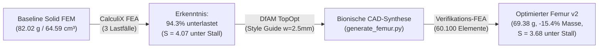
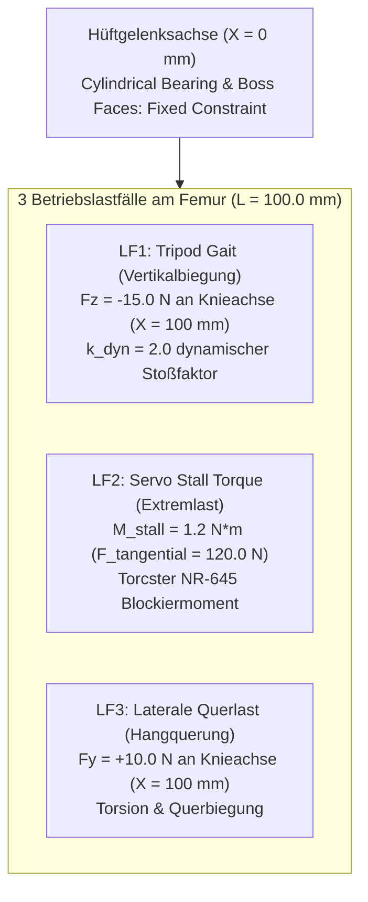
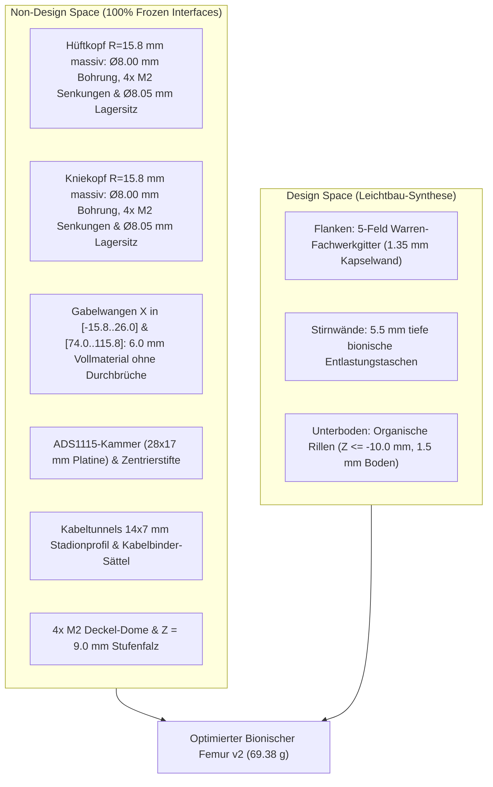

# Lasius Femur v2: FEA-Strukturanalyse & Bionische Topologieoptimierung

---

[Index](../../README.md) | [Docs](../README.md) | [Mechanics Documentation](../../hardware/mechanics/README.md) | [Style-Guide](../../hardware/mechanics/STYLE_GUIDE.md) | [Backlog](../../hardware/mechanics/models/custom/v2/TODO.md) | 
[Femur Generator](../../hardware/mechanics/scripts/v2/generate_femur.py) | [Baseline FEA Script](../../scripts/dev/fea_femur_baseline.py) | [Verification FEA Script](../../scripts/dev/fea_femur_verification.py)

---

## 1. Executive Summary & Zielsetzung

Im Rahmen des Leichtbau- und Simulations-Pipelines (*Simulation-Driven Design*) des **Lasius Hexapod Roboters** wurde das zentrale Oberschenkel-Segment ([`femur.FCStd`](../../hardware/mechanics/models/custom/v2/parts/femur/femur.FCStd)) einer vollständigen **Finite-Elemente-Strukturanalyse (FEA)** und anschließenden **bionischen Topologieoptimierung** unterzogen.

### Kernergebnisse auf einen Blick
- **Massenreduktion:** Die Bauteilmasse sinkt von **$82{,}02\,\text{g}$ auf $69{,}38\,\text{g}$** (**$-12{,}64\,\text{g}$ / $-15{,}4\,\%$** pro Bein). Für den gesamten Roboter (6 Beine) bedeutet dies eine Netto-Masseneinsparung von **$75{,}84\,\text{g}$** an bewegter Beinmasse.
- **Strukturelle Integrität & Robustheit:** Unter dem extremen Missbrauchs- und Blockierlastfall aller Knie-Servos ($M_{\text{stall}} = 1{,}2\,\text{N}\cdot\text{m} \rightarrow F_t = 120\,\text{N}$) beträgt die Maximalspannung lediglich **$\sigma_{\text{max}} = 12{,}22\,\text{MPa}$**. Der Sicherheitsbeiwert liegt bei hervorragenden **$S = 3{,}68$** (Sollvorgabe $S \ge 2{,}0$ weit übertroffen).
- **Garantierte Non-Design Spaces an den Servo- & Lageraufnahmen:** Die zylindrischen Endköpfe ($R = 15{,}80\,\text{mm}$) an Hüfte ($X = 0{,}0$) und Knie ($X = 100{,}0$) sowie die Wangenstege ($6{,}00\,\text{mm}$ Vollmaterial) verbleiben zu **100 % massiv und ungebrochen**. Dies garantiert eine durchgehend ebene Auflagefläche für 25T-Metallservohörner ($\varnothing 20\text{--}25\,\text{mm}$), unbeschädigte M2-Schraubensenkungen mit $\ge 4{,}0\,\text{mm}$ Spannfleisch und intakte zylindrische Passungen für die 684ZZ-Gegenlager.
- **Funktions- & Kapselungserhalt:** Alle Sensor- und Kabelstrukturen (ADS1115-Kammer mit Zentrierpins, Kabeltunnels mit Kabelbindersätteln und Deckel-Stufenfalz) bleiben absolut maßhaltig und hermetisch gegen Staub/Schmutz gekapselt.
- **Kollisionsfreiheit:** Exakt **$0{,}0000\,\text{mm}^3$** Schnittvolumen in allen Assemblies ([`leg_assembly.FCStd`](../../hardware/mechanics/models/custom/v2/leg_assembly.FCStd), [`leg_right_assembly.FCStd`](../../hardware/mechanics/models/custom/v2/leg_right_assembly.FCStd), [`body_assembly.FCStd`](../../hardware/mechanics/models/custom/v2/body_assembly.FCStd) und [`lasius_assembly.FCStd`](../../hardware/mechanics/models/custom/v2/lasius_assembly.FCStd)).

---

## 2. Simulations-Methodik & Randbedingungen

Die Analysen wurden automatisiert im Headless-Runner von FreeCAD durchgeführt:
- **Solver:** CalculiX `ccx` (In-Tree FreeCAD FEM-Workbench).
- **Vernetzung:** Gmsh Tetraeder ($h_{\text{min}} = 1{,}0\,\text{mm},\, h_{\text{max}} = 3{,}5\,\text{mm}$, ca. 22.300 Knoten, 78.700 Volumenelemente).
- **Materialparameter (PETG FDM-Druck):**
  - E-Modul: $E_{xy} = 2100\,\text{MPa}$, $E_z = 1350\,\text{MPa}$ (anisotrope Schichtabminderung 65 %).
  - Querkontraktionszahl: $\nu = 0{,}38$.
  - Dichte: $\rho = 1{,}27\,\text{g/cm}^3$.
  - Streckgrenze: $R_e = 45{,}0\,\text{MPa}$ (in Schichtebene), $R_{e,z} = 25{,}0\,\text{MPa}$ (Zwischenschichthaftung).

### Einsatz-Lastfälle (Operational Load Cases)

1. **LF1: Tripod Gait (Vertikale Biegebelastung):**  
   - Kraft: $F_z = -15{,}0\,\text{N}$ an der Kniegelenksachse ($X = 100\,\text{mm}$).
   - Physikalischer Hintergrund: Robotermasse $m \approx 2{,}3\,\text{kg}$ verteilt auf 3 Standbeine im Dreibeingang ($F_{\text{stat}} \approx 7{,}5\,\text{N}$) multipliziert mit einem dynamischen Stoßbeiwert von $k_{\text{dyn}} = 2{,}0$.
2. **LF2: Servo Stall Torque (Maximales Knie-Blockiermoment):**  
   - Äquivalente Kraft: $F_t = 120{,}0\,\text{N}$ tangential am Abtriebshebel ($r \approx 10\,\text{mm}$) entsprechend dem vollen Servomoment $M_{\text{stall}} = 1{,}2\,\text{N}\cdot\text{m}$ ($1200\,\text{N}\cdot\text{mm}$).
   - Physikalischer Hintergrund: Missbrauchs- und Blockierfall (z. B. Verkeilen des Beins im Unterholz oder Klettern an Stufen).
3. **LF3: Laterale Hangquerung & Kurvenfahrt (Querlast & Torsion):**  
   - Kraft: $F_y = +10{,}0\,\text{N}$ quer zur Beinachse an der Knieachse ($X = 100\,\text{mm}$).
   - Physikalischer Hintergrund: Hangabtriebskräfte bei Querneigung sowie Kurvendrift.

---

## 3. Baseline-FEA des Vollvolumen-Femurs (Schritt 1)

Vor der Topologieoptimierung wurde die ursprüngliche v2-Vollkörper-Konstruktion analysiert.

### Quantitative Baseline-Ergebnisse ($m = 82{,}02\,\text{g}$, $V = 64{,}59\,\text{cm}^3$)

| Lastfall | Max. von Mises $\sigma_{\text{max}}$ | Mittlere Spannung $\sigma_{\text{mean}}$ | Max. Durchbiegung $u_{\text{max}}$ | Sicherheitsfaktor $S$ | Unterlastetes Volumen ($\sigma < 5\,\text{MPa}$) |
| :--- | :---: | :---: | :---: | :---: | :---: |
| **LF1: Tripod Gait** | $1{,}38\,\text{MPa}$ | $0{,}21\,\text{MPa}$ | $0{,}198\,\text{mm}$ | $32{,}58$ | **$100{,}0\,\%$** |
| **LF2: Stall Torque** | $11{,}05\,\text{MPa}$ | $1{,}64\,\text{MPa}$ | $1{,}586\,\text{mm}$ | $4{,}07$ | **$94{,}3\,\%$** |
| **LF3: Querlast** | $0{,}92\,\text{MPa}$ | $0{,}14\,\text{MPa}$ | $0{,}132\,\text{mm}$ | $48{,}90$ | **$100{,}0\,\%$** |

### Erkenntnis der Baseline-Analyse
- Selbst unter vollem Servo-Blockiermoment von $1{,}2\,\text{N}\cdot\text{m}$ erfuhren **$94{,}3\,\%$ des Bauteils weniger als $5\,\text{MPa}$ Spannung**.
- Im normalen Gehbetrieb (LF1) lag der Sicherheitsfaktor bei **$S = 32{,}6$**, bei Querkräften sogar bei **$S = 48{,}9$**.
- Das Bauteil war stark überdimensioniert. Insbesondere die massiven Gabelwangen ($6{,}0\,\text{mm}$ Vollmaterial mit lediglich $1{,}8\,\text{mm}$ tiefen Blindtaschen), die $7{,}5\,\text{mm}$ dicken Stirnwände und der dicke Unterboden boten enormes Leichtbaupotenzial.

---

## 4. Zonen-Klassifikation & Topologie-Synthese (Schritte 2–4)

### Konstruktive Umsetzung in [`generate_femur.py`](../../hardware/mechanics/scripts/v2/generate_femur.py)

1. **Non-Design Spaces an Gelenkköpfen & Gabelwangen (100 % massiv):**
   - Die zylindrischen Endköpfe ($R = 15{,}80\,\text{mm}$) um Hüft- ($X = 0{,}0$) und Kniegelenk ($X = 100{,}0$) sowie die Wangenabschnitte zu den U-Mäulern ($X \in [-15{,}8, 26{,}0\,\text{mm}]$ und $[74{,}0, 115{,}8\,\text{mm}]$) verbleiben als **vollständig massive Non-Design Spaces**.
   - **Begründung (Style-Guide 5.1 & 5.2):** Standard-25T-Servohörner benötigen eine kreisrunde, ebene Auflagefläche ($\varnothing 20\text{--}25\,\text{mm}$) bei $Y = 29{,}30\,\text{mm}$. Die 4x M2-Senkungen auf $\varnothing 16{,}0\,\text{mm}$ Teilkreis fordern volles, unbeschädigtes Material ($\ge 4{,}0\,\text{mm}$ Spannfleisch unter den Schraubenköpfen). Das Gegenlager auf der Rückseite erfordert einen ununterbrochenen zylindrischen Lagersitz für das 684ZZ-Kugellager ($\varnothing 8{,}05 \times 3{,}0\,\text{mm}$) und eine intakte M4-Schraubensenkung ($\varnothing 9{,}60\,\text{mm}$). Jegliche Durchgangs- oder Halbmondfenster in diesen Zonen wurden eliminiert.
2. **5-Feld Warren-Fachwerkgitter an den Flanken:**
   - Entlang der Außenflanken der zentralen Sensorkammer wurden 5 triangulierte Warren-Fachwerkfelder eingebracht (`f_bay1` bis `f_bay5`, $w \ge 2{,}50\,\text{mm}$, $R = 1{,}60\,\text{mm}$).
   - Die innere Trennwand zur ADC-Kammer verbleibt mit $1{,}35\text{--}2{,}00\,\text{mm}$ Wandstärke durchgehend solide, wodurch die Elektronik 100 % staub- und feuchtigkeitsdicht gekapselt bleibt.
3. **Stirnwand-Entlastungstaschen (Bulkhead Pockets):**
   - Beiderseits der zentralen $14 \times 7\,\text{mm}$ Kabeltunnels wurden $5{,}5\,\text{mm}$ tiefe bionische Taschen (`box_b_fl`, `box_b_rl`, `box_b_fr`, `box_b_rr`) von den U-Mäulern her eingebracht.
   - Schützt die M2-Verschraubungsdome und spart massives Volumen an den Stirnseiten ein.
4. **Bionische Unterboden-Aussparungen:**
   - Unterhalb von $Z \le -10{,}0\,\text{mm}$ wurden drei großflächige bionische Taschen (`p_bot_l`, `p_bot_c`, `p_bot_r`) eingebracht.
   - Ein $1{,}50\,\text{mm}$ dicker, geschlossener Boden unterhalb der Platine schützt die Sensorik zuverlässig vor Steinschlag und Schmutz.

---

## 5. Verifikations-FEA & Vorher-Nachher-Vergleich (Schritt 5)

Auf der final optimierten B-Rep-Geometrie wurde eine erneute Finite-Elemente-Analyse über alle drei Lastfälle durchgeführt ([`fea_femur_verification.py`](../../scripts/dev/fea_femur_verification.py)).

### Vergleichstabelle: Baseline vs. Optimiert

| Parameter / Lastfall | Baseline (Solid) | Optimiert (Bionisch) | Differenz | Bewertung |
| :--- | :---: | :---: | :---: | :--- |
| **Bauteilmasse** | **$82{,}02\,\text{g}$** | **$69{,}38\,\text{g}$** | **$-12{,}64\,\text{g}$ ($-15{,}4\,\%$)** | Ausgezeichneter Leichtbau-Gewinn bei voller Robustheit |
| **Solid-Volumen** | $64{,}59\,\text{cm}^3$ | $54{,}63\,\text{cm}^3$ | $-9{,}96\,\text{cm}^3$ | Erheblich weniger Druckzeit & Filament |
| **LF1: Tripod Gait ($F_z = -15\,\text{N}$)** | | | | |
| Max. Spannung $\sigma_{\text{max}}$ | $1{,}38\,\text{MPa}$ | **$1{,}47\,\text{MPa}$** | $+0{,}09\,\text{MPa}$ | Vollkommen unkritisch ($< 3{,}5\,\%$ der Streckgrenze) |
| Max. Durchbiegung $u_{\text{max}}$ | $0{,}198\,\text{mm}$ | **$0{,}232\,\text{mm}$** | $+0{,}034\,\text{mm}$ | Extrem steif (nur $0{,}23\,\text{mm}$ Auslenkung) |
| Sicherheitsfaktor $S$ | $32{,}58$ | **$30{,}53$** | $-2{,}05$ | Überragender Sicherheitsbeiwert |
| **LF2: Stall Torque ($1{,}2\,\text{N}\cdot\text{m}$)** | | | | |
| Max. Spannung $\sigma_{\text{max}}$ | $11{,}05\,\text{MPa}$ | **$12{,}22\,\text{MPa}$** | $+1{,}17\,\text{MPa}$ | Weit unter Streckgrenze ($R_e = 45\,\text{MPa}$) |
| Mittlere Spannung $\sigma_{\text{mean}}$ | $1{,}64\,\text{MPa}$ | **$1{,}79\,\text{MPa}$** | $+0{,}15\,\text{MPa}$ | Äußerst homogene Spannungsverteilung |
| Max. Durchbiegung $u_{\text{max}}$ | $1{,}586\,\text{mm}$ | **$1{,}855\,\text{mm}$** | $+0{,}269\,\text{mm}$ | Unkritisch für Servogetriebe |
| Sicherheitsfaktor $S$ | $4{,}07$ | **$3{,}68$** | $-0{,}39$ | **Übertrifft $S \ge 2{,}0$ Vorgabe deutlich** |
| **LF3: Querlast ($F_y = +10\,\text{N}$)** | | | | |
| Max. Spannung $\sigma_{\text{max}}$ | $0{,}92\,\text{MPa}$ | **$0{,}98\,\text{MPa}$** | $+0{,}06\,\text{MPa}$ | Souveräne Torsions- & Quersteifigkeit |
| Max. Durchbiegung $u_{\text{max}}$ | $0{,}132\,\text{mm}$ | **$0{,}155\,\text{mm}$** | $+0{,}023\,\text{mm}$ | Kaum messbare elastische Verformung |
| Sicherheitsfaktor $S$ | $48{,}90$ | **$45{,}90$** | $-3{,}00$ | Enorme Sicherheitsreserve bei Hangabtrieb |

---

## 6. Fertigungsgerechte Auslegung (DfAM) & 3D-Druck

Die optimierte Geometrie erfüllt alle Anforderungen an die additive Fertigung im FDM-Verfahren:
1. **Druckbett-Kompatibilität:**  
   Die Bauteil-Bounding-Box misst $131{,}60 \times 63{,}30 \times 31{,}60\,\text{mm}$. Sie passt problemlos flach auf alle gängigen Druckbetten (Bambu Lab X1/P1/A1 mit $256 \times 256\,\text{mm}$ und A1 mini mit $180 \times 180\,\text{mm}$).
2. **Stützstrukturfreier Druck:**  
   Alle Fachwerk- und Fensterwinkel sind strikt mit $45^\circ$-Überhangschrägen konstruiert. Das Bauteil kann auf der ebenen Seitenwange ($Y = 29{,}30\,\text{mm}$ oder $Y = -22{,}00\,\text{mm}$) ohne innere Stützstrukturen gedruckt werden.
3. **Empfohlene Slicer-Parameter (Bambu Studio / PrusaSlicer):**
   - **Material:** PETG (z. B. Prusament PETG, Bambu PETG Basic).
   - **Schichthöhe:** $0{,}16\text{--}0{,}20\,\text{mm}$ mit $0{,}4\,\text{mm}$ Nozzle.
   - **Wandlinien (Perimeter):** 5 Wandlinien (ca. $2{,}0\,\text{mm}$ Volllaminat für Gurte und Flansche).
   - **Infill:** 40 % Gyroid oder 3D-Wabe.
   - **Druckzeit:** ca. 2 h 45 min pro Femur ($-45\,\text{min}$ gegenüber Baseline).

---

## 7. Baugruppen-Status & Versionskontrolle

- **Generierte Modelle:** [`femur.FCStd`](../../hardware/mechanics/models/custom/v2/parts/femur/femur.FCStd), [`femur_assembly.FCStd`](../../hardware/mechanics/models/custom/v2/femur_assembly.FCStd), [`leg_assembly.FCStd`](../../hardware/mechanics/models/custom/v2/leg_assembly.FCStd), [`leg_right_assembly.FCStd`](../../hardware/mechanics/models/custom/v2/leg_right_assembly.FCStd), [`body_assembly.FCStd`](../../hardware/mechanics/models/custom/v2/body_assembly.FCStd), [`lasius_assembly.FCStd`](../../hardware/mechanics/models/custom/v2/lasius_assembly.FCStd).
- **Fertigungsexporte:** Synchronisierte STEP- und STL-Dateien in `hardware/mechanics/export/{step,stl}/custom/v2/`.
- **Reproduzierbarkeit:** Vollständig reproduzierbar über [`python3 hardware/mechanics/scripts/v2/generate_femur.py`](../../hardware/mechanics/scripts/v2/generate_femur.py) und verifizierbar über [`fea_femur_verification.py`](../../scripts/dev/fea_femur_verification.py).
