# Elektronik-Testbench: Initiales Bring-Up Setup (Status & Handover)

*Persistierter Status für die nächste Session: Schrittweises Inbetriebnehmen des TCA9548A I2C-Multiplexers und der ADS1115 16-Bit AD-Wandler auf dem Breadboard.*

---

## 1. Aktueller Status auf einen Blick

```mermaid
flowchart LR
    S1["✔ Schritt 1: Vorbereitung & A0=0x71<br><b>[ERLEDIGT]</b>"] --> S2["⏳ Schritt 2: Pi 4 Verdrahtung<br><b>[NÄCHSTE SESSION]</b>"]
    S2 --> S3["Schritt 3: i2cdetect Scan (0x71)<br><i>[Ausstehend]</i>"]
    S3 --> S4["Schritt 4: ADS1115 an CH0<br><i>[Ausstehend]</i>"]
    S4 --> S5["Schritt 5: Sub-Bus Test (0x48)<br><i>[Ausstehend]</i>"]
    S5 --> S6["Schritt 6: Live-Messung A0<br><i>[Ausstehend]</i>"]

    style S1 fill:#1b4d3e,stroke:#2ecc71,stroke-width:2px,color:#fff
    style S2 fill:#7a4b00,stroke:#f39c12,stroke-width:3px,color:#fff
    style S3 fill:#2c3e50,stroke:#7f8c8d,stroke-width:1px,color:#bdc3c7
    style S4 fill:#2c3e50,stroke:#7f8c8d,stroke-width:1px,color:#bdc3c7
    style S5 fill:#2c3e50,stroke:#7f8c8d,stroke-width:1px,color:#bdc3c7
    style S6 fill:#2c3e50,stroke:#7f8c8d,stroke-width:1px,color:#bdc3c7
```



* **Bereits abgeschlossen:** **Schritt 1** (Adressierung auf `0x71` per Lötbrücke/Pin A0 festgelegt, Spannungsprüfung auf 3.3V verifiziert).
* **Direkter Einstiegspunkt für nächste Session:** **Schritt 2** (TCA9548A Multiplexer an den 40-Pin Header des Raspberry Pi 4 anschließen).

---

## 2. Der 6-Schritte-Inbetriebnahmefahrplan

### ✔ Schritt 1: Vorbereitung & Adressprüfung [ABGESCHLOSSEN]
* **Ziel:** Adresskonflikte mit den PCA9685 Servotreibern ausschließen.
* **Ergebnis:** TCA9548A ist auf Basisadresse **`0x71`** konfiguriert (Lötbrücke A0 geschlossen bzw. A0 auf 3.3V).
* **Hintergrund:** Die Default-Adresse `0x70` ist durch den PCA9685 All-Call-Modus belegt und darf nicht verwendet werden.
* **Sicherheitsregel:** Alle Leitungen laufen strikt auf **3.3V** Logikspannung (Raspberry Pi GPIOs sind nicht 5V-tolerant).

---

### ⏳ Schritt 2: TCA9548A an Raspberry Pi 4 anschließen [NÄCHSTE AKTION]
* **Ziel:** Physische 4-Draht-I2C-Verbindung zwischen Raspberry Pi 4 und Breadboard herstellen.
* **Aktion:** Schließe die folgenden 4 Dupont-Jumperkabel (Buchse-Stecker) bei ausgeschaltetem Pi an:

| Raspberry Pi 4 (40-Pin Header) | Signal | TCA9548A Multiplexer Pin | Anmerkung |
|---|---|---|---|
| **Pin 1** | **3.3V Power** | `VIN` / `VCC` | Logikversorgung (Niemals Pin 2 / 5V!) |
| **Pin 6** (oder 9, 14, 20) | **GND** | `GND` | Gemeinsame Masse |
| **Pin 3** (GPIO 2) | **I2C1 SDA** | `SDA` | Datenleitung Hauptbus |
| **Pin 5** (GPIO 3) | **I2C1 SCL** | `SCL` | Taktleitung Hauptbus |
| *(Interne Brücke)* | **3.3V** | `A0` | Falls keine Lötbrücke vorhanden: Pin A0 fest auf 3.3V stecken |
| *(Offen / GND)* | **GND** | `A1`, `A2` | Unbeschaltet lassen (Logisch 0) |

* **Bestätigung für Session-Start:** Sobald die 4 Leitungen gesteckt sind, Pi booten und Rückmeldung geben.

---

### Schritt 3: Funktionstest via Terminal (`i2cdetect`) [AUSSTEHEND]
* **Ziel:** Sicherstellen, dass der Multiplexer auf dem primären I2C-Bus antwortet.
* **Befehl auf dem Raspberry Pi:**
  ```bash
  i2cdetect -y 1
  ```
* **Erwartetes Ergebnis:** In der Zeile `70:` muss der Eintrag `71` sichtbar sein:
  ```text
       0  1  2  3  4  5  6  7  8  9  a  b  c  d  e  f
  70: -- 71 -- -- -- -- -- --
  ```
* **Diagnose mit dem Lasius-Testtool:**
  ```bash
  python3 scripts/bench/test_electronics.py --step 3
  ```

---

### Schritt 4: ADS1115 ADC an Sub-Kanal 0 anbinden [AUSSTEHEND]
* **Ziel:** Den ersten 16-Bit AD-Wandler an Sub-Kanal 0 des TCA9548A anschließen.
* **Verdrahtung auf dem Breadboard:**
  * TCA9548A `3.3V` $\rightarrow$ ADS1115 `VDD`
  * TCA9548A `GND` $\rightarrow$ ADS1115 `GND`
  * TCA9548A **`SD0`** $\rightarrow$ ADS1115 **`SDA`**
  * TCA9548A **`SC0`** $\rightarrow$ ADS1115 **`SCL`**
  * ADS1115 **`ADDR`** $\rightarrow$ `GND` (konfiguriert I2C-Adresse `0x48`)

---

### Schritt 5: Sub-Bus-Umschaltung & ADC-Erkennung verifizieren [AUSSTEHEND]
* **Ziel:** Testen, ob der Raspberry Pi über den Multiplexer auf den isolierten Sub-Bus schalten und den ADS1115 ansprechen kann.
* **Befehl:**
  ```bash
  python3 scripts/bench/test_electronics.py --step 5
  ```
* **Erwartetes Ergebnis:** `✔ ERFOLG: ADS1115 erkannt auf Sub-Kanal 0 (Adresse 0x48)!`

---

### Schritt 6: Analoge Testspannung an A0 auslesen [AUSSTEHEND]
* **Ziel:** Kalibrierte Spannungsmessung eines analogen Potentiometers oder Sensors.
* **Verdrahtung:**
  * Potentiometer Pin 1 an `GND`, Pin 3 an `3.3V`.
  * Schleifer (Mittelabgriff) an ADS1115 **`A0`**.
* **Befehl für Live-Monitor:**
  ```bash
  python3 scripts/bench/test_electronics.py --channel 0 --read-analog 0
  ```
* **Erwartetes Ergebnis:** Drehen am Potentiometer erzeugt eine stufenlose Spannungsanzeige von $0{,}000\,\text{V}$ bis $3{,}300\,\text{V}$ mit 16-Bit Auflösung ($0$ bis $32767$ Counts).

---

## 3. Bereitgestellte Werkzeuge & Dokumente im Repository

1. **Automatisches Diagnosetool:**
   [`scripts/bench/test_electronics.py`](../../scripts/bench/test_electronics.py)
   * Unterstützt `--scan`, `--step 1..6`, `--channel 0..7`, `--read-analog 0..3` und `--mock`.
2. **Ausführlicher Leitfaden & Verdrahtungsplan:**
   [`docs/hardware/electronics_testbench_guide.md`](electronics_testbench_guide.md)
3. **Bus-Topologie (BOM, SVG & YAML):**
   [`hardware/electronics/wiring/01_i2c_sensor_bus_topology.yml`](../../hardware/electronics/wiring/01_i2c_sensor_bus_topology.yml)

---

## 4. Befehl zum direkten Einstieg in der nächsten Session

Sag beim Start der nächsten Session einfach:
> *"Weiter mit Schritt 2 der Elektronik-Testbench"*

Der Agent wird diesen Leitfaden sofort aufschlagen und mit der Verdrahtungsprüfung von Schritt 2 beginnen!
