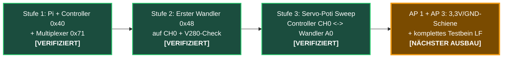

# Elektronik-Testbench: Initiales Bring-Up & Verifikationsstatus (`bkhexapod`)

*Verifikationsstand der I²C-Testbench mit **Controller** (`PCA9685`), **Multiplexer** (`PCA9548A` / `PW548A`) und **Wandler** (`ADS1115 V280`) am Raspberry Pi 4 (`bkhexapod`).*

---

## 1. Aktueller Status auf einen Blick

* **Verifiziert (Stufen 1–3 auf `bkhexapod`):**
  1. **Hauptbus-Daisy-Chain (`Pi 4 → Controller [0x40] → Multiplexer [0x71]`):** Stabil ohne `0x70 ALLCALL`-Konflikt; alle 8 Sub-Kanäle (`CH0–CH7`) sauber umschaltbar.
  2. **Erster Wandler (`ADS1115 V280`, `0x48`) an `CH0 (LF)`:** Referenzpunkte `GND = 0,0000 V` (`raw = 0`) und `3,3 V = 3,3100 V` (`raw = 26480`) bestätigt.
     * **Hardware-Befund (`PW548A` & `V280`):** Violetter **Multiplexer** hat `10 kΩ`-Pull-downs auf `A0–A2`, `10 kΩ`-Pull-ups auf `RST/SDA/SCL` und **keine** `3,3 V/GND`-Pins auf `CH0–CH7`. Der blaue `V280`-**Wandler** besitzt die Pin-Reihenfolge **`SCL` vor `SDA`** und liefert linksbündige **12-Bit**-Werte (`2,0 mV/Schritt` $\approx 0{,}26^\circ$).
  3. **Closed-Loop Servo-Poti-Sweep (`Controller CH0` ↔ `Wandler A0`, `6,0 V` + `Star-GND`):** Linearität $R^2 = 0{,}999876$, Steigung $+7{,}530\,\text{mV}/^\circ$ (`132,802 °/V`), $V_{0^\circ} = 1{,}5590\,\text{V}$, max. Modellabweichung $5{,}1\,\text{mV}$ (`0,68°`). *(Hinweis: Vor dem 1. PWM-Puls liegt der Poti-Abgriff bei `~0,266 V`, danach bleibt der Messwert auch nach `relax()` stabil.)*
* **Nächster Einstiegspunkt:** **AP 1 & AP 3** in [`hardware/electronics/TODO.md`](../../hardware/electronics/TODO.md) (`3,3 V / GND`-Verteilerschiene bauen, Femur `A1` + Tibia `A2` + Fußschalter `A3` an `CH0` aufbauen und `4× 100 nF` unter Last testen).

---

## 2. Referenz der 6 Inbetriebnahme-Schritte (alle initialen Bring-Up-Schritte abgeschlossen)

### ✔ Schritt 1: Vorbereitung & Adressprüfung [ABGESCHLOSSEN]
* **Ziel:** Adresskonflikte mit den `PCA9685`-**Controllern** ausschließen.
* **Ergebnis:** **Multiplexer** (`PCA9548A` / `PW548A`) fest auf Basisadresse **`0x71`** konfiguriert (`A0 → 3,3 V`, da keine frontseitige Lötbrücke vorhanden ist).
* **Hintergrund:** `0x70` ist für PCA9685 `ALLCALL` reserviert (`lasius-core` löscht `_ALLCALL` beim Init zusätzlich in `MODE1 = 0x20`).
* **Sicherheitsregel:** Alle Logik- und Analogleitungen strikt auf **`3,3 V`** halten (Pi GPIOs sind nicht 5V-tolerant; Poti-Abgriff per Multimeter $\le 3{,}3\,\text{V}$ verifiziert).

---

### ✔ Schritt 2: Multiplexer in Daisy-Chain mit Controller an Pi 4 anschließen [ABGESCHLOSSEN]
* **Ziel:** Physische 4-Draht-`I2C1`-Verbindung zwischen Pi 4, **Controller (`0x40`)** und **Multiplexer (`0x71`)** herstellen.

| Raspberry Pi 4 (40-Pin Header) | Signal | Farbe (Master-Schema) | Zielpin (**Controller** / **Multiplexer**) | Anmerkung |
|---|---|---|---|---|
| **Pin 1** | **3.3V Logik** | **Rot (`RD`)** | `Controller VCC`, `Mux VIN` & `A0` | Niemals `5 V` (Pin 2/4) oder `V+` (`6 V`)! |
| **Pin 6** (oder 9, 14, 20) | **GND** | **Schwarz (`BK`)** | `GND` | Gemeinsame Logikmasse (`Star-GND`) |
| **Pin 3** (GPIO 2) | **I2C1 SDA** | **Blau (`BU`)** | `SDA` | Hauptbus-Datenleitung (Daisy-Chain) |
| **Pin 5** (GPIO 3) | **I2C1 SCL** | **Gelb (`YE`)** | `SCL` | Hauptbus-Taktleitung |
| *(Board-Pull-down)* | **GND** | *(intern `10 kΩ`)* | `A1`, `A2` am **Multiplexer** | Unbeschaltet $\to$ Logisch `0` |

---

### ✔ Schritt 3: Funktionstest via Terminal (`i2cdetect` / `--step 3`) [ABGESCHLOSSEN]
* **Ergebnis auf `bkhexapod`:** `i2cdetect -y 1` meldet **`0x40`** (**Controller**) und **`0x71`** (**Multiplexer**); `test_electronics.py --step 3` erfolgreich, alle 8 Kanäle (`CH0–CH7`) umschaltbar.

---

### ✔ Schritt 4: Ersten Wandler (`V280`) an Sub-Kanal 0 (`LF`) anbinden [ABGESCHLOSSEN]
* **Verdrahtung (`CH0 / LF`, beachte `V280`: `SCL` vor `SDA`!):**
  * `3,3 V` (**Rot**) $\rightarrow$ **Wandler** `VDD`
  * `GND` (**Schwarz**) $\rightarrow$ **Wandler** `GND`
  * **Multiplexer `SC0`** (**Gelb**) $\rightarrow$ **Wandler `SCL`** *(Pin 3 auf dem V280!)*
  * **Multiplexer `SD0`** (**Blau**) $\rightarrow$ **Wandler `SDA`** *(Pin 4 auf dem V280!)*
  * **Wandler `ADDR`** (**Schwarz**) $\rightarrow$ `GND` (`0x48`)

---

### ✔ Schritt 5: Sub-Bus-Umschaltung & Wandler-Erkennung verifizieren [ABGESCHLOSSEN]
* **Ergebnis auf `bkhexapod`:** `test_electronics.py --step 5` und `--scan` erkennen **`0x48` exklusiv auf `CH0`**.

---

### ✔ Schritt 6: Kalibrierte Spannungsmessung & Closed-Loop Servo-Sweep an `A0` [ABGESCHLOSSEN]
* **Befehl:** `python3 scripts/bench/test_electronics.py --channel 0 --read-analog 0`
* **Ergebnis auf `bkhexapod`:**
  * Kalibriercheck an `A0`: `GND = 0,0000 V` (`raw = 0`), `3,3 V = 3,3100 V` (`raw = 26480`).
  * Live-Sweep `-60°` bis `+60°` mit `Reely NR-645 MG BB` an `Controller CH0` (`6,0 V` + `Star-GND`, Schleifer **Weiß** an `Wandler A0`): $R^2 = 0{,}999876$, `+7,530 mV/°`, Umkehrdifferenz `-0,2 mV` bei `0°`.
  * **Hinweis:** Die getestete `V280`-Charge liefert linksbündige **12-Bit**-Auflösung (`16 Counts = 2,0 mV` je Stufe $\approx 0{,}26^\circ$, Spannungsskalierung `0,125 mV/LSB` bleibt unverändert).

---

## 3. Bereitgestellte Werkzeuge & Dokumente im Repository

1. **Elektronik-Backlog, Master-Farbschema & AP 1–5:**
   [`hardware/electronics/TODO.md`](../../hardware/electronics/TODO.md)
2. **Automatisches Diagnosetool:**
   [`scripts/bench/test_electronics.py`](../../scripts/bench/test_electronics.py)
   * Unterstützt `--scan`, `--step 1..6`, `--channel 0..7`, `--read-analog 0..3` und `--mock`.
3. **Ausführlicher Leitfaden & Verdrahtungsplan:**
   [`docs/hardware/electronics_testbench_guide.md`](electronics_testbench_guide.md)
4. **Bus-Topologie & Beinkabelbaum (WireViz BOM, SVG & YAML):**
   [`hardware/electronics/wiring/01_i2c_sensor_bus_topology.yml`](../../hardware/electronics/wiring/01_i2c_sensor_bus_topology.yml) · [`02_single_leg_feedback_harness.yml`](../../hardware/electronics/wiring/02_single_leg_feedback_harness.yml)

---

## 4. Nächster Einstiegspunkt

Für die Fortsetzung am Aufbau:
> *"Weiter mit AP 1 (`3,3 V / GND`-Verteilerschiene) oder AP 3 (Testbein `LF` komplett auf `CH0`)"*

Details zu den offenen Arbeitspaketen stehen in [`hardware/electronics/TODO.md`](../../hardware/electronics/TODO.md).
