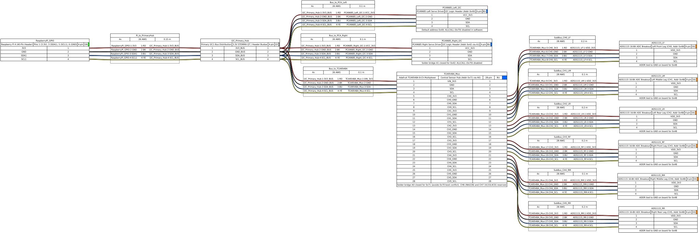
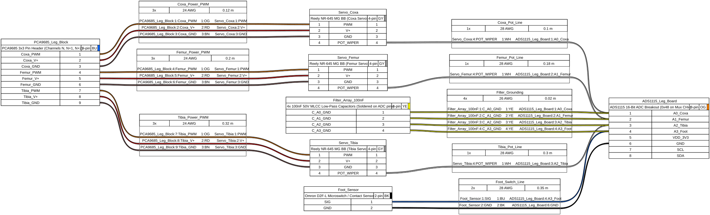
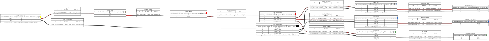
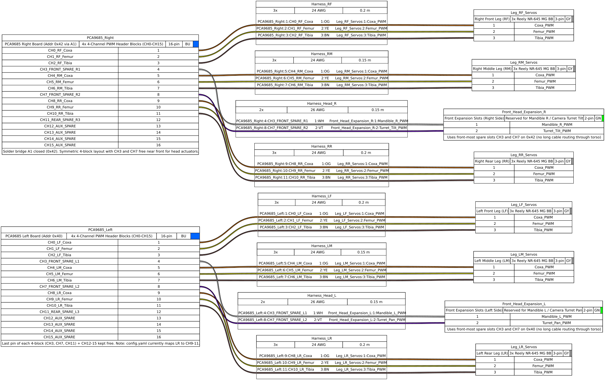

# Hexapod:Lasius – Wiring Plan: Electrical & Sensor Architecture

---

[Index](../../README.md) | [Software](../../software/README.md) | [Hardware](../../hardware/README.md) | [Docs](../../docs/README.md) | [Data](../../data/README.md) | [Scripts](../../scripts/README.md) | 
[Decisions](../../docs/hardware/decisions.md) | [Closed Loop](../../docs/hardware/closed_loop_plan.md) | [Wiring](../../docs/hardware/wiring_plan.md) | [Gamepad](../../docs/pilot/gamepad_stadia.md) | [Roadmap](../../docs/roadmap.md) |

---

Complete electrical connection plans, I2C sensor bus topology, single leg feedback harnesses, power distribution, and PCA9685 servo channel allocation for Hexapod:Lasius.

Detailed hardware specifications and formulas:
- Master Specification: [`closed_loop_plan.md`](closed_loop_plan.md)
- WireViz Harness Sources & BOMs: [`../../hardware/electronics/wiring/README.md`](../../hardware/electronics/wiring/README.md)

---

## 1. I2C Sensor & Actuation Bus Topology

Master I2C1 routing from Raspberry Pi 4 to the dual PCA9685 servo drivers (`0x40` Left, `0x42` Right) and through the TCA9548A multiplexer (`0x71`) with 4-wire sub-buses (`3.3V`, `GND`, `SDA`, `SCL`) to 6× ADS1115 16-bit ADC boards (`0x48`):

  

---

## 2. Single Leg Feedback Harness (3-DOF + Contact Switch)

Modular wiring harness per leg connecting Coxa, Femur, and Tibia internal servo potentiometers and the tactile Omron D2F-L foot switch to the dedicated leg ADS1115 board with soldered 100 nF RC low-pass filtering and 10 kΩ pull-up resistor on `A3`:

  

---

## 3. Power Distribution & Star Ground Scheme

Dual-rail power distribution from the XT60BE-M inlet (bench supply or 2S/3S LiPo) through a 25A inline blade fuse and master switch to dual 6.0V high-current UBECs for left/right servo banks, a 5.1V 4A buck converter for Raspberry Pi 4 logic, and a centralized star ground busbar:

  

---

## 4. PCA9685 18-DOF Servo Distribution & Front Expansion Slots

Symmetric 4-block channel assignment on `PCA9685 Left (0x40)` and `PCA9685 Right (0x42)`: each leg occupies the first 3 pins of a 4-channel block (`CH0–2`, `CH4–6`, `CH8–10`), leaving the 4th pin of the front blocks (`CH3`, `CH7`) directly accessible at the front of the chassis for future head actuators (Mandibles & Camera Turret Pan/Tilt), plus `CH11` and `CH12–15` as spare reserve channels:

  

