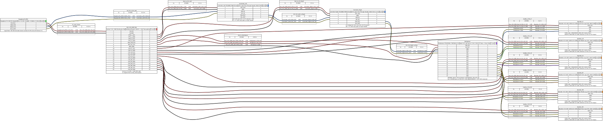
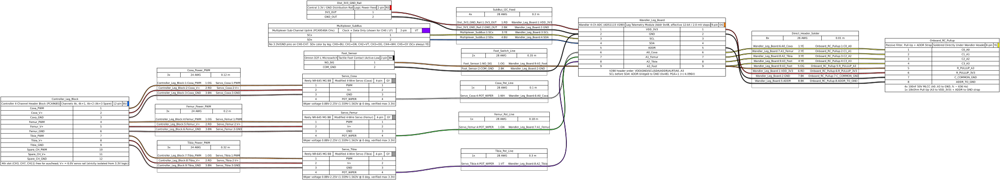
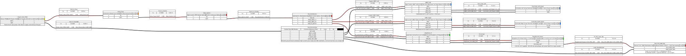
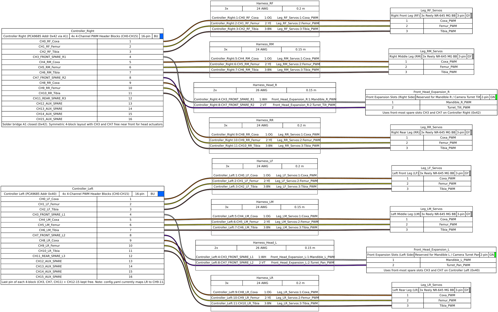

# Hexapod:Lasius – Wiring Plan: Electrical & Sensor Architecture

---

[Index](../../README.md) | [Software](../../software/README.md) | [Hardware](../../hardware/README.md) | [Docs](../../docs/README.md) | [Data](../../data/README.md) | [Scripts](../../scripts/README.md) | 
[Decisions](../../docs/hardware/decisions.md) | [Closed Loop](../../docs/hardware/closed_loop_plan.md) | [Wiring](../../docs/hardware/wiring_plan.md) | [Gamepad](../../docs/pilot/gamepad_stadia.md) | [Roadmap](../../docs/roadmap.md) |

---

Complete electrical connection plans, I2C sensor bus topology, single leg feedback harnesses, power distribution, and PCA9685 servo channel allocation for Hexapod:Lasius.

Detailed hardware specifications and formulas:
- Master Specification: [`closed_loop_plan.md`](closed_loop_plan.md)
- WireViz Harness Sources & BOMs: [`../../hardware/electronics/wiring/README.md`](../../hardware/electronics/wiring/README.md)

---

## 1. I2C Sensor & Actuation Bus Topology

Master `I2C1` daisy-chain from Raspberry Pi 4 through **Controller Left (`0x40`)** and **Controller Right (`0x42`)** to the **Multiplexer (`PCA9548A / PW548A` at `0x71`)**, combined with the centralized **`3.3V / GND` Distribution Rail** (`Dist_3V3_GND_Rail`) and Y-split 4-wire harnesses (`3.3V [RD]`, `GND [BK]`, `SCx [YE]`, per-channel `SDx`) to 6× **Wandler** boards (`ADS1115 V280` at `0x48`, `SCL`-before-`SDA` pinout, effective 12-bit / `2.0 mV` steps):

  

---

## 2. Single Leg Feedback Harness (3-DOF + Contact Switch)

Modular wiring harness per leg following the Master Color Scheme (`A0` Coxa **White**, `A1` Femur **White**, `A2` Tibia **White** [servo pot lines are always white], `A3` Omron D2F-L foot switch **Orange** + `COM -> GND` **Black**) feeding the leg **Wandler** (`ADS1115 V280`, `SCL` before `SDA`) via split `3.3V / GND` + `SCx / SDx` uplink, with onboard `4× 100 nF` RC low-pass filters, `10 kΩ` pull-up on `A3`, and `ADDR -> GND` strap (`0x48`):

  

---

## 3. Power Distribution & Star Ground Scheme

Dual-rail power distribution from the hatch-accessible `2S LiPo / Bench XT60` connector (no redundant external rear inlet; rear Gaster dovetail preserved) through an external-access `25A Mini-ATM` blade fuse (`Rear-Right Waist` in Concept A, or `Power-Gaster Left Flank` in separate model G2) to dual `6.0V` **Hobbywing BEC 10A V2-Car (`HW30603003`)** UBECs feeding left/right **Controller** servo rails, switched electronically via a compact **2-pole Mini Slide Switch (`Servos Armed`)**. A separate **SPST Mini Slide Switch (`Pi Logic`)** feeds the `5.1V 3A–4A` buck converter for Raspberry Pi 4 logic, a central `3.3V / GND` Sensor Hub rail fed from Pi `Pin 1/17`, and a centralized star ground busbar (`Star_Ground_Bus`, coupled to the `3.3V` rail via one single reference wire):

  

---

## 4. PCA9685 18-DOF Servo Distribution & Front Expansion Slots

Symmetric 4-block channel assignment on **Controller Left (`0x40`)** and **Controller Right (`0x42`)**: each leg occupies the first 3 pins of a 4-channel block (`CH0–2`, `CH4–6`, `CH8–10`), leaving the 4th pin of the front blocks (`CH3`, `CH7`) directly accessible at the front of the chassis for future head actuators (Mandibles & Camera Turret Pan/Tilt), plus `CH11` and `CH12–15` as spare reserve channels:

  

