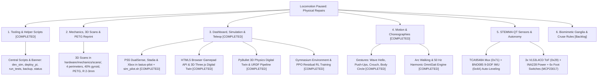

# Hexapod:Lasius – Task List, Backlog & Roadmap

---

[Index](../README.md) | [Software](../software/README.md) | [Hardware](../hardware/README.md) | [Docs](../docs/README.md) | [Data](../data/README.md) | [Scripts](../scripts/README.md) | 
[Domain Architecture](domain_architecture.md) | [Decisions](hardware/decisions.md) | [Closed Loop](hardware/closed_loop_plan.md) | [Wiring](hardware/wiring_plan.md) | [Gamepad](pilot/gamepad_stadia.md) | [Roadmap](roadmap.md) |

---

This document serves as the centralized task list, roadmap, and backlog for the continuous development of the Hexapod:Lasius robot (setup guides, developer workflows, and helper scripts are documented in [`README.md`](../README.md), and complete system architecture in [`domain_architecture.md`](domain_architecture.md)).

---

## 1. Current Project Status (Status: November 2026)

### Mechanical Status
* **Status:** **Full physical locomotion temporarily paused.**
* **Root Cause:** Several 3D-printed Coxa brackets (hip joints) fractured under load and must be reprinted.
* **Consequence:** Physical walking and payload tests on desk/floor are temporarily paused until reinforced PETG reprints are mounted.

### Software, Simulation & Digital Twin Status
* **Status:** **100% operational, modular, fully simulatable with 3D physics and Reinforcement Learning.**
* **Backend (`lasius-core`):**
  * 4-layer decoupled architecture (HAL, kinematics/motion, OrderDispatcher, HTTP REST & WebSocket server).
  * 50 Hz harmonic cosine locomotion engine ($C^1$-continuous, $>5\times$ acceleration jerk reduction) with `engage=False` on startup (servos unpowered at boot) and explicit [`locomotion_active`](../software/lasius-core/src/lasius/core/robot.py) arbitration state machine.
  * Thread-safe I2C bus (`threading.RLock`) and disabled PCA9685 `_ALLCALL` bit (`0x70`) in [`driver.py`](../software/lasius-core/src/lasius/core/hardware/driver.py) in preparation for the PCA9548 I2C multiplexer.
  * Jerk-free cosine trajectory entry/exit interpolation in [`dispatcher.py`](../software/lasius-core/src/lasius/core/control/dispatcher.py): starting angles calculated from live servo positions or neutral stance height ($z = -80\,\text{mm}$), preventing sudden 0° sag.
* **3D Physics Digital Twin & Reinforcement Learning:**
  * FreeCAD CAD solid mass and inertia tensor extraction (`scripts/sim/extract_inertias.py`) and URDF model generation (`scripts/sim/export_urdf.py`).
  * PyBullet 3D physics engine (`scripts/sim/run_simulation.py`) with 250 Hz physics stepping, Coulomb friction ($\mu = 1.2$), and embedded WebSocket bridge (`ws://127.0.0.1:8765`).
  * Symmetrical standing posture verified (12 contact points at $Z = 161.5\,\text{mm}$).
  * Gymnasium environment [`LasiusGymEnv`](../software/lasius-core/src/lasius/core/sim/gym_env.py) (66-dim observation, 18-dim continuous action, Residual RL).
  * Stable-Baselines3 PPO training pipeline (`scripts/sim/train_rl.py`) running at >420 FPS on CPU.
* **Frontend (`lasius-dashboard`):**
  * Modern Vue 3 + TypeScript + Pinia Single-Page Application (SFCs, reusable `JointCard.vue`).
  * 3D Digital Twin (Three.js WebGL via `shallowRef` & zero-leak buffer updates in [`updateFanGeometry`](../software/lasius-dashboard/src/engine/lasiusGraphics.ts) / [`disposeObject3D`](../software/lasius-dashboard/src/engine/lasiusGraphics.ts)): dual-plate sandwich chassis, inward-extended coxa brackets (30 mm), unified PBR material (`#343746`), forward orientation chevron.
  * 2D CAD orthographic projections: straight vectors (`ctx.lineTo`) without curved distortion.
* **Teleoperation (`lasius-pilot`):**
  * Native support for **Sony PlayStation 5 DualSense**, **Google Stadia**, and **Xbox** controllers via Linux `/dev/input/js0`.
  * Orchestration script [`scripts/sim/sim_pilot.sh`](../scripts/sim/sim_pilot.sh) for concurrent PyBullet simulation and gamepad teleoperation with single-signal lifecycle management.
* **Automated Tests:**
  * **66 tests** (60 in `lasius-core` including `test_gym_env.py`, 6 in `lasius-pilot`), 100% passing.

---

## 2. Task Backlog & Milestones

Because the entire system can be simulated independently of physical hardware using [`MockPWMDriver`](../software/lasius-core/src/lasius/core/hardware/driver.py) and the 3D Digital Twin, development proceeds seamlessly:

### Milestone 1: Tooling, Helper Scripts & CI [COMPLETED]
* **Goal:** Standardized scripts for daily development workflows (simulation, deployment, backup, health check) with centralized ASCII banner [`scripts/banner.txt`](../scripts/banner.txt).
* **Location:** [`scripts/`](../scripts/) folder (workflows documented in [`scripts/README.md`](../scripts/README.md)).

### Milestone 2: Mechanical Optimization & CAD Reconstruction (`hardware/mechanics/`)
* **3D Scanning & Reverse Engineering:**
  * Scan broken original parts (Coxa 60 mm, Femur 100 mm, Tibia 130 mm) and store mesh data in [`hardware/mechanics/scans/`](../hardware/mechanics/scans/).
  * Parametric reconstruction as clean OpenCASCADE B-Rep solids with exact inter-axis spacing (**60 mm / 100 mm / 130 mm**).
* **Fabrication & Slicing Specifications:**
  * **Material:** **PETG** (tough-elastic, will not shatter under shock loads).
  * **Print Orientation:** Print parts flat on bed so tensile/bending stresses align with continuous extrusion paths.
  * **Perimeters & Infill:** **4 perimeters (1.6 mm wall thickness)**, **40% gyroid infill**, **5 top/bottom layers (1.0 mm)**, 0.20 mm layer height at 240–245 °C with minimal part cooling (max. 20–30%) for maximum interlayer adhesion.
  * **Structural Reinforcement:** Fillet sharp 90° interior corners ($R \ge 2\text{--}3\,\text{mm}$), increase wall thickness around 25T servo horns to $\ge 3.5\text{--}4.0\,\text{mm}$, and incorporate M3 heat-set brass threaded inserts.

### Milestone 3: Dashboard, Simulation, Teleoperation & Reinforcement Learning [COMPLETED]
* **Google Stadia, PS5 DualSense & Xbox Profiles (`lasius-pilot` & `lasius-dashboard`) [COMPLETED]:**
  * Declarative YAML profiles (`profiles/ps5.yaml`, `profiles/stadia.yaml`, `profiles/xbox.yaml`) with auto-detection, manual selector in dashboard (`GET /api/v1/gamepads`), and browser control via `navigator.getGamepads()`.
  * Dedicated orchestration launcher [`scripts/sim/sim_pilot.sh`](../scripts/sim/sim_pilot.sh) for concurrent PyBullet simulation and PS5 DualSense teleoperation with signal-trapped clean shutdown.
* **Calibration Profile Management (Export / Import) [COMPLETED]:**
  * Download `calibration.json` (`Export JSON`) and upload/restore (`Import JSON`) directly inside the *Leg Control* sidebar tab.
* **3D Ground Contact Indicators & Foot Trails [COMPLETED]:**
  * Live ground contact glow rings under Tibia tips in stance phase ($z \le -75\,\text{mm}$) and toggleable 3D foot trajectory curves (`Trails: ON/OFF`) in the 3D viewport.
* **Kinematic Ground Coupling (`Ground Lock` vs. `Test Stand`) & Odometry Grid [COMPLETED]:**
  * 2-stage least-squares support plane calculation (`fitSupportPlane` & `computeWorldKinematics`): supporting feet remain grounded ($Z = -80\,\text{mm}$) while chassis dynamically tilts, rolls, pitches, and lifts during *Push-Ups*, *Crouch*, *Body Circle*, and walking.
  * Slip-free ground propulsion: 3D floor grid scrolls and rotates synchronously under grounded stance legs (`Ground: ON`), toggleable to stationary workbench mode (`Test Stand`).
* **Rigid Body Physics Digital Twin (PyBullet & MuJoCo via URDF) [COMPLETED]:**
  * Headless FreeCAD inertia tensor extraction (`scripts/sim/extract_inertias.py`) and parametric URDF generation (`scripts/sim/export_urdf.py`).
  * Symmetrical standing posture verified in PyBullet (12 contact points at $Z = 161.5\,\text{mm}$, 0.0° roll/pitch/yaw).
  * Integrated 50 Hz WebSocket server bridge in PyBullet GUI (`ws://0.0.0.0:8765`) enabling live teleoperation without physical robot.
* **Gymnasium Environment & PPO Reinforcement Learning [COMPLETED]:**
  * Standardized Gymnasium environment [`LasiusGymEnv`](../software/lasius-core/src/lasius/core/sim/gym_env.py) with 66-dimensional observation space and 18-dimensional continuous action space.
  * Residual Reinforcement Learning: PPO policy learns adaptive joint offsets ($\pm 11.5^\circ$) on top of analytical 50 Hz `OmniGait` trajectories.
  * Multi-env training pipeline ([`scripts/sim/train_rl.py`](../scripts/sim/train_rl.py)) achieving >420 FPS on CPU, saving checkpoints, and 3D policy evaluator ([`scripts/sim/eval_rl.py`](../scripts/sim/eval_rl.py)).

### Milestone 4: Gestures, Poses & Choreographies (`lasius-core`) [COMPLETED]
* **Show Poses & Acrobatic Actions [COMPLETED]:**
  * `WAVE_HELLO`: Lifts front leg and waves Tibia/Coxa back and forth while remaining 5 legs maintain balanced stance.
  * `PUSH_UPS`: Rhythmic vertical body pumping via sinusoidal interpolation ($-50\,\text{mm}$ to $-108\,\text{mm}$).
  * `BODY_CIRCLE`: Smooth 6-DOF circular body revolution coupling roll and pitch angles.
  * `CROUCH`: Low lurking stance with tilted nose (`height: -48 mm`, `pitch: -12°`).
* **Arc Walking [COMPLETED]:**
  * Continuous simultaneous translation ($X/Y$) and yaw rotation ($Z$) for smooth circular path following via 50 Hz harmonic `OmniGait`.

### Milestone 5: Sensors & Autonomy (STEMMA QT / Qwiic Bus)
* **I2C Multiplexer & Architecture:**
  * **Adafruit PCA9548 8-Channel STEMMA QT Multiplexer (`0x70` / `0x71`)** as central sensor hub (bus collision protection with PCA9685 `_ALLCALL` active in software).
* **IMU Driver & Auto-Leveling:**
  * **Adafruit BNO085 9-DOF Orientation IMU (`0x4A`)** with on-chip sensor fusion (quaternions, gravity vector).
  * Closed-loop PID attitude control in `lasius-core`: ground slope angles are automatically compensated by inverse body roll and pitch adjustments.
* **Current & Voltage Telemetry:**
  * **2× Adafruit INA260 (`0x41` Left, `0x44` Right)** for real-time monitoring of voltage (V), current (A), and power (W) per servo bank, including low-voltage cut-off protection.
* **ToF Obstacle Avoidance & Tactile Foot Switches:**
  * **3× Adafruit VL53L4CD ToF Distance Sensors (`0x29` on Mux channels 0, 1, 2)** for proximity sensing (1–1300 mm, front left/center/right).
  * **6× Subminiature Lever Microswitches** at Tibia tips via **Adafruit MCP23017 I2C GPIO Expander (`0x20`)** for reactive ground contact sensing on rough terrain.

### Milestone 6: Analog Servo Potentiometer Feedback (Closed-Loop Telemetry) [IN PROGRESS]
* **Potentiometer Feedback:** Tapping internal feedback wiper of Reely NR-645 MG BB servos for direct joint angle telemetry, stall detection, and torque estimation.
* **Calibration Tooling [COMPLETED]:** Interactive CLI wizard [`scripts/bench/pot_calibration_wizard.py`](../scripts/bench/pot_calibration_wizard.py) with cosine interpolation and linear regression.
* **Calibration Findings ([`data/bench/`](../data/bench/)) [COMPLETED]:** Empirically verified on Channel 15 ($R^2 = 0.9996$, sensitivity $7.59\,\text{mV}/^\circ$, zero point $1.5633\,\text{V}$ at $0^\circ$, max error $\pm 1.45^\circ$).
* **Closed-Loop Formula:** $\theta(V) = (V - 1.5633) \cdot 131.77^\circ$.
* **Hardware Integration Testbench [IN PROGRESS]:** 6× ADS1115 ADCs over TCA9548A multiplexer (`0x71`) with 100 nF low-pass RC filters (currently in wiring step 2; see [`docs/hardware/closed_loop_plan.md`](hardware/closed_loop_plan.md)).

### Milestone 7: Biomimetic Locomotion & Decentralized Ganglia Architecture [Backlog]
* **Biological Principle:** Insects lack a centralized high-capacity brain; high-level cognition commands only locomotion intentions (`direction`, `speed`, `gait_intent`), delegating phase coordination to thoracic ganglia and local reflex loops.
* **Detailed Specification:** Tracked in [`software/TODO.md`](../software/TODO.md):
  * **Decentralized Leg Controllers (`Walknet` / Cruse Rules 1–6):** Emergent coordination via peer leg coupling and stance-load triggers instead of static global cosine timing.
  * **Local Sensory Reflex Loops:** In-flight elevator reflex (obstacle hopping via ADC lag) and landing search reflex (tactile microswitches).
  * **Top-Level Cognitive Decoupling:** Subsumption behavior tree where all joint angles and inverse kinematics are strictly encapsulated away from application/pilot layers.
