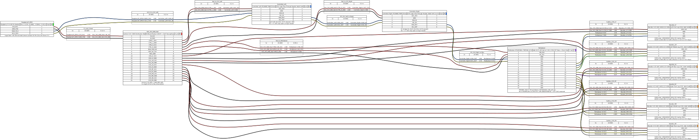
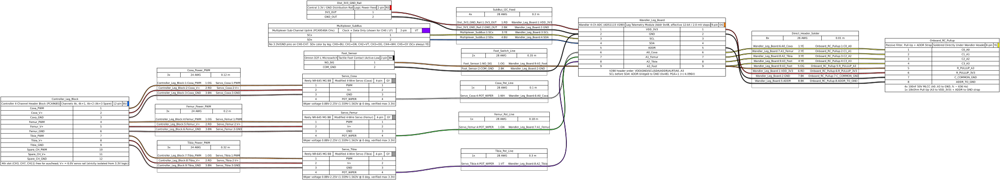
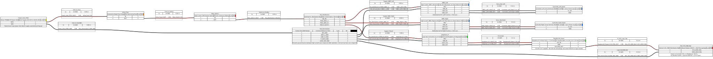
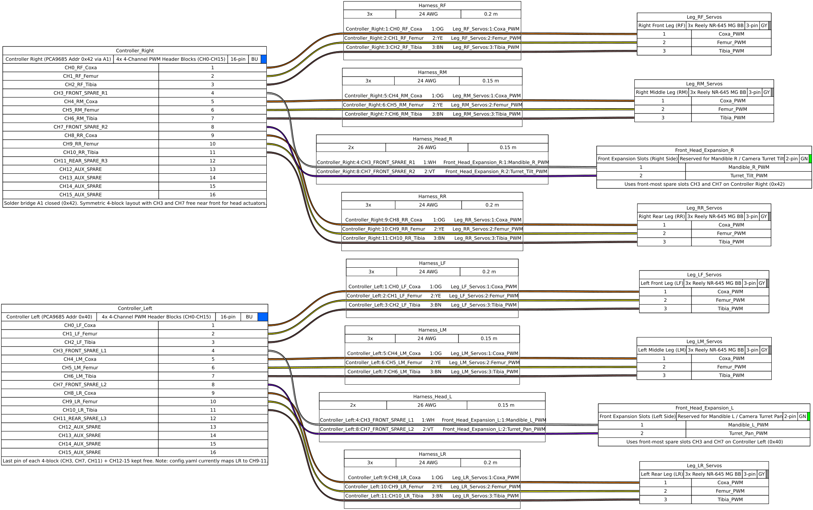

# Lasius Hexapod: Wiring & Harnesses

---

[Index](../../../README.md) | [Software](../../../software/README.md) | [Hardware](../../../hardware/README.md) | [Docs](../../../docs/README.md) | [Data](../../../data/README.md) | [Scripts](../../../scripts/README.md) |<br>
[Mechanics](../../../hardware/mechanics/README.md) | [Electronics / Wiring](../../../hardware/electronics/wiring/README.md) | [Electronics TODO](../TODO.md) | [Harness Spec](../WIRING_HARNESS_SPEC.md) |

---

This directory contains the complete electrical wiring and harness specifications for the **Hexapod:Lasius Robot** documented in **WireViz ("Cabling as Code")** format.

> **Board Naming Convention:** Throughout all schematics and bench guides, **Controller** refers to the `PCA9685` PWM drivers, **Multiplexer** refers to the `PCA9548A`/`TCA9548A` I2C hub, and **Wandler** refers to the `ADS1115 (V280)` ADC breakouts.

## 1. Hardware Components

| Component | Quantity | Function & Specifications |
| :--- | :---: | :--- |
| **Raspberry Pi 4** | 1× | Primary compute & kinematics controller. I2C1 master on GPIO 2 (`SDA1`, Pin 3) and GPIO 3 (`SCL1`, Pin 5) at 3.3V logic; Pins 1/17 supply the ~60–100 mA logic rail. |
| **Controllers (`PCA9685`)** | 2× | 16-Channel 12-bit PWM servo drivers daisy-chained on primary I2C bus (`0x40` Left, `0x42` Right with `A1` bridged; `ALLCALL 0x70` cleared in software; `OE` & `V+` open on logic side header). |
| **Multiplexer (`PCA9548A` / `PW548A`)** | 1× | Purple 8-channel I2C hub at **`0x71`** (`A0` wired to `3.3V` to avoid `0x70` `ALLCALL` conflicts). Board carries `10 kΩ` pull-downs (`R6/R1/R2`) on `A0–A2` and `10 kΩ` pull-ups (`R3/R4/R5`) on `RST/SDA/SCL`; sub-channels `CH0–CH7` carry **`SDx / SCx` only** (no per-channel `3.3V`/`GND` pins). |
| **Central `3.3V / GND` Rail** | 1× | Perfboard distribution busbar (`100 nF` + `10 µF` decoupling) splitting Pi `3.3V` & `GND` centrally to Controllers, Multiplexer (`VIN` + `A0`), and all 6 Wandler boards; coupled via **1 single reference wire** to `Star_Ground_Bus`. |
| **Wandler (`ADS1115 V280`)** | 6× | 4-Channel I2C ADCs (1 board per leg) at **`0x48`** (`ADDR` tied to `GND`) across `CH0–CH5`. Hardware verified on `bkhexapod`: header pin order has **`SCL` before `SDA`** (`VDD \| GND \| SCL \| SDA \| ADDR \| ALRT \| A0–A3`) and tested V280 silicon delivers left-aligned **12-bit** resolution (`2.0 mV`/step, ~`0.26°` at the servo pot). |
| **Reely NR-645 MG BB** | 18× | Metal-gear servos (3 per leg: Coxa, Femur, Tibia). Internal potentiometer wiper wire exposed for closed-loop telemetry ($0.88\text{–}2.25\,\text{V}$, verified $\le 3.3\,\text{V}$). |
| **Omron D2F-L** | 6× | Tactile microswitches in foot tips wired directly to `A3` (Orange) & `GND` (Black) of each leg Wandler (active-low to `GND`). |
| **10 kΩ Resistor** | 6× | Pull-up resistors soldered between `A3` and `VDD` (`3.3V`) on each Wandler header to prevent floating inputs when foot switches are open. |
| **100 nF MLCC** | 24× | 0.1 µF 50V monolithic multi-layer ceramic capacitors as low-pass noise filters ($f_c \approx 636\,\text{Hz}$) soldered directly between `A0–A3` and `GND`. |
| **Amass XT60BE-M** | 1× | Rear chassis power inlet for bench power supply (`6.0V` during bring-up) or 2S/3S LiPo battery. |
| **Inline Blade Fuse** | 1× | 25A automotive blade fuse immediately downstream of the positive power inlet for short-circuit protection. |
| **Master Power Switch** | 1× | High-current SPST rocker/toggle switch rated for $\ge 20\,\text{A}$ continuous DC load. |
| **High-Current UBECs** | 2× | 6.0V (10A–15A) step-down regulators (or direct 6V bench supply rails) feeding `V+` on `Controller Left (0x40)` and `Controller Right (0x42)`. |
| **Step-Down Converter** | 1× | 5.1V 4.0A DC/DC buck converter dedicated to the Raspberry Pi 4 logic supply. |
| **Planned Expansion** | — | **Adafruit BNO085** 9-DOF IMU (`0x4A` primary bus), **INA228 / INA260** power monitor (`Multiplexer CH6`, Brown/Yellow), **VL53L4CD / VL53L5CX** ToF sensor (`Multiplexer CH7`), and front head servos (Camera Pan/Tilt + Mandibles). |

---

## 2. Master Color Scheme

Standardized wire color allocation across all WireViz harnesses and bench wiring (full German reference in [`../TODO.md`](../TODO.md)):

| Signal / Scope | Color (WireViz Code) | Targets |
| :--- | :--- | :--- |
| **`3.3V` Logic Supply** | **Red** (`RD`) | `Pi Pin 1/17` $\rightarrow$ `Dist_3V3_GND_Rail` $\rightarrow$ Controllers `VCC`, Multiplexer `VIN + A0`, Wandler `VDD` *(never 5V / V+)* |
| **`GND`, `ADDR` & Foot `COM`** | **Black** (`BK`) | Logic `GND` rail (single tie to `Star_Ground_Bus`), Wandler `ADDR -> GND`, Foot switch `COM` |
| **`SCL` / `SCx` I2C Clock** | **Yellow** (`YE`) | Primary bus `SCL1` and every Multiplexer sub-channel clock `SC0–SC7` |
| **Main Bus `SDA` & `CH0 (LF)` `SD0`** | **Blue** (`BU`) | `Pi SDA1` daisy-chained through `Controller Left` / `Controller Right` to `Multiplexer`, plus `CH0 (LF)` data |
| **Multiplexer Sub-Channels `SD1–SD6`** | `GN` / `VT` / `OG` / `WH` / `GY` / `BN` | `CH1 (LM)` **Green**, `CH2 (LR)` **Violet**, `CH3 (RF)` **Orange**, `CH4 (RM)` **White**, `CH5 (RR)` **Grey**, `CH6 (INA228)` **Brown** |
| **Analog Inputs `A0–A3` (Per Leg)** | `WH` / `OG` | `A0` Coxa **White**, `A1` Femur **White**, `A2` Tibia **White** *(Poti-Leitung aus den Servos immer Weiß)*, `A3` Foot Switch `NO` **Orange** |

---

## 3. Wiring Plans & Schematics

### Plan 1: `01_i2c_sensor_bus_topology.yml`
* **Purpose:** Visualizes the primary I2C1 daisy-chain (`Pi 4 → Controller Left 0x40 → Controller Right 0x42 → Multiplexer 0x71`), the **Central `3.3V / GND` Distribution Rail**, and the 6 Y-split 4-wire leg harnesses (`3.3V [RD]`, `GND [BK]`, `SCx [YE]`, leg `SDx` color) feeding the 6 **Wandler** boards (`V280` `VDD | GND | SCL | SDA` pin order).
* **Channel Allocation:**
  * `CH0`: Left Front Leg (`Wandler_LF`, `0x48`, `SD0 = Blue`)
  * `CH1`: Left Middle Leg (`Wandler_LM`, `0x48`, `SD1 = Green`)
  * `CH2`: Left Rear Leg (`Wandler_LR`, `0x48`, `SD2 = Violet`)
  * `CH3`: Right Front Leg (`Wandler_RF`, `0x48`, `SD3 = Orange`)
  * `CH4`: Right Middle Leg (`Wandler_RM`, `0x48`, `SD4 = White`)
  * `CH5`: Right Rear Leg (`Wandler_RR`, `0x48`, `SD5 = Grey`)

<p align="center">
  
</p>

### Plan 2: `02_single_leg_feedback_harness.yml`
* **Purpose:** Detailed wiring harness for an individual 3-DOF leg combining the split uplink (`Dist_3V3_GND_Rail` + `Multiplexer CHx SCx/SDx`), Master Color Scheme analog lines, onboard RC filtering, `ADDR -> GND` strap (`0x48`), and foot switch pull-up.
* **Signals & Filters (Soldered Directly on `Wandler_Leg_Board` `V280` Header — `SCL` before `SDA`):**
  * `A0` (**White**): Coxa servo potentiometer wiper + `100 nF` to `GND` *(verified on `bkhexapod`: $R^2 = 0.999876$, $+7.530\,\text{mV}/^\circ$)*
  * `A1` (**White**): Femur servo potentiometer wiper + `100 nF` to `GND` *(Poti-Leitung aus dem Servo immer Weiß)*
  * `A2` (**White**): Tibia servo potentiometer wiper + `100 nF` to `GND` *(Poti-Leitung aus dem Servo immer Weiß)*
  * `A3` (**Orange** `NO` / **Black** `COM`): Omron D2F-L foot contact switch + `10 kΩ` pull-up to `VDD_3V3` + `100 nF` to `GND`
  * 3-pin PWM power and signal leads (Orange/Red/Brown) to `Controller_Leg_Block` 4-channel block (4th slot left free)
* **Filter Cutoff Frequency:**
  $$f_c = \frac{1}{2 \pi \cdot R_{\text{pot}} \cdot C} \approx \frac{1}{2 \pi \cdot 2500\,\Omega \cdot 100\,\text{nF}} \approx 636\,\text{Hz}$$
  *(Effectively suppresses high-frequency PWM switching transients and motor brush noise).*

<p align="center">
  
</p>

### Plan 3: `03_power_distribution.yml`
* **Purpose:** Power distribution rails, inline fuse protection, dual `6.0V` servo rails, centralized `Star_Ground_Bus`, and the `3.3V` logic rail tap.
* **Branches:**
  * Bench Supply / 2S–3S LiPo (`XT60BE-M`) $\rightarrow$ `25A` Inline Blade Fuse $\rightarrow$ `20A` Master Power Switch
  * Dual High-Current UBECs (`6.0V 10A–15A` each, or direct 6V bench supply) $\rightarrow$ `Controller_Left_Power (0x40)` and `Controller_Right_Power (0x42)` servo power terminals
  * Step-Down Converter (`5.1V 4.0A`) $\rightarrow$ Raspberry Pi 4 logic supply; Pi Pin 1/17 (`3.3V`) feeds `Dist_3V3_GND_Rail`
  * Central Star-Ground Busbar (`Star_Ground_Bus`) carries high-current battery/UBEC returns and connects to `Dist_3V3_GND_Rail` via **exactly one** reference link (`LOGIC_REF_GND`) to eliminate ground loops and ground bounce.

<p align="center">
  
</p>

### Plan 4: `04_pca9685_servo_distribution.yml`
* **Purpose:** Complete 18-DOF servo channel allocation across both **Controller** boards (`Controller_Left 0x40`, `Controller_Right 0x42`) plus reserved front expansion slots for future head actuators (Camera Turret Pan/Tilt & Mandibles).
* **4-Block Symmetry & Expansion Strategy:**
  * **Block 0 (Front):** `CH0` (Coxa), `CH1` (Femur), `CH2` (Tibia) for `LF`/`RF` — **`CH3` reserved at front** (Mandible Left / Right).
  * **Block 1 (Front-Mid):** `CH4` (Coxa), `CH5` (Femur), `CH6` (Tibia) for `LM`/`RM` — **`CH7` reserved near front** (Camera Turret Pan / Tilt).
  * **Block 2 (Rear):** `CH8` (Coxa), `CH9` (Femur), `CH10` (Tibia) for `LR`/`RR` — **`CH11` spare** *(synchronized across `Controller_Left`, `Controller_Right`, and [`config.yaml`](../../../software/lasius-core/src/lasius/core/config.yaml))*.
  * **Block 3 (Aux Reserve):** **`CH12–CH15` completely free** (4 spare channels per board).

<p align="center">
  
</p>

---

## 4. Regenerating WireViz Schematics & BOMs

All diagrams can be compiled on demand without manual system packages using `uv`:

```bash
cd hardware/electronics/wiring
uv run wireviz 01_i2c_sensor_bus_topology.yml 02_single_leg_feedback_harness.yml 03_power_distribution.yml 04_pca9685_servo_distribution.yml
```

WireViz automatically produces for each YAML definition:
* `.svg`: Scalable vector graphic for web and documentation
* `.png`: High-resolution raster preview
* `.html`: Interactive schematic with clickable component metadata
* `.bom.tsv`: Tabular bill of materials (connectors, wires, lengths, gauges)
