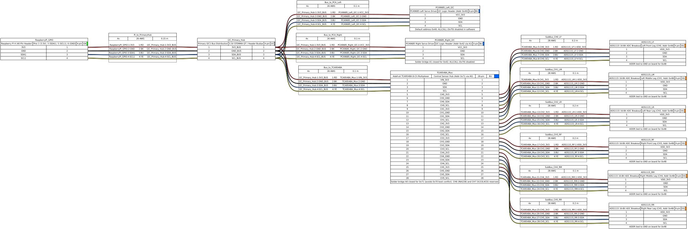
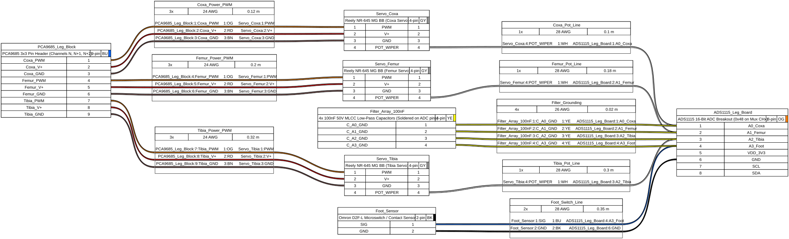
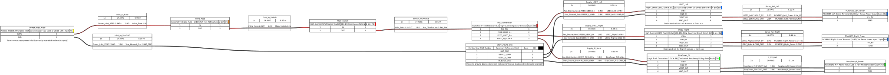
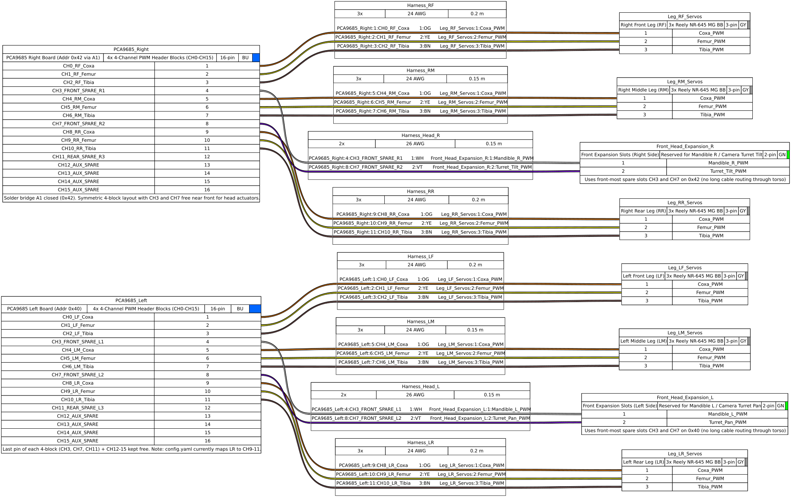

# Lasius Hexapod: Wiring & Harnesses

---

[Index](../../../README.md) | [Software](../../../software/README.md) | [Hardware](../../../hardware/README.md) | [Docs](../../../docs/README.md) | [Data](../../../data/README.md) | [Scripts](../../../scripts/README.md) |<br>
[Mechanics](../../../hardware/mechanics/README.md) | [Electronics / Wiring](../../../hardware/electronics/wiring/README.md) |

---

This directory contains the complete electrical wiring and harness specifications for the **Hexapod:Lasius Robot** documented in **WireViz ("Cabling as Code")** format.

## 1. Hardware Components

| Component | Quantity | Function & Specifications |
| :--- | :---: | :--- |
| **Raspberry Pi 4** | 1× | Primary compute & kinematics controller. I2C1 master on GPIO 2 (`SDA1`, Pin 3) and GPIO 3 (`SCL1`, Pin 5) at 3.3V logic level. |
| **TCA9548A** | 1× | 8-Channel I2C multiplexer (1.8V–5V, logic at 3.3V). Configured to address **`0x71`** via solder bridge on `A0` (avoids `0x70` `ALLCALL` conflict). |
| **ADS1115** | 6× | 16-Bit 4-channel precision ADCs (1 board per leg). All set to default address **`0x48`** (`ADDR` tied to `GND`) across isolated sub-channels `CH0` to `CH5`. |
| **PCA9685** | 2× | 16-Channel 12-bit PWM servo drivers on primary I2C bus (`0x40` Left, `0x42` Right with `A1` bridged). |
| **Reely NR-645 MG BB** | 18× | Metal-gear servos (3 per leg: Coxa, Femur, Tibia). Internal potentiometer wiper wire exposed for closed-loop telemetry ($0.88\text{–}2.25\,\text{V}$). |
| **Omron D2F-L** | 6× | Tactile microswitches in foot tips wired to pin `A3` of each leg ADS1115 board (active-low to `GND`). |
| **10 kΩ Resistor** | 6× | Pull-up resistors soldered between `A3` and `VDD` (3.3V) on each ADS1115 header to prevent floating inputs when foot switches are open. |
| **100 nF MLCC** | 24× | 0.1 µF 50V monolithic multi-layer ceramic capacitors as low-pass noise filters ($f_c \approx 636\,\text{Hz}$) soldered directly between `A0–A3` and `GND`. |
| **Amass XT60BE-M** | 1× | Rear chassis power inlet for bench power supply (current setup) or 2S/3S LiPo battery. |
| **Inline Blade Fuse** | 1× | 25A automotive blade fuse immediately downstream of the positive power inlet for short-circuit protection. |
| **Master Power Switch** | 1× | High-current SPST rocker/toggle switch rated for $\ge 20\,\text{A}$ continuous DC load. |
| **High-Current UBECs** | 2× | 6.0V (10A–15A) step-down regulators (or direct 6V bench supply rails) feeding `V+` on `PCA9685 Left (0x40)` and `PCA9685 Right (0x42)`. |
| **Step-Down Converter** | 1× | 5.1V 4.0A DC/DC buck converter dedicated to the Raspberry Pi 4 logic supply. |
| **Planned Expansion** | — | **Adafruit BNO085** 9-DOF IMU (`0x4A` primary bus), **2× INA228** power monitors (`Mux CH6`), **VL53L4CD** ToF sensor (`Mux CH7`), and front head servos (Camera Pan/Tilt + Mandibles). |

---

## 2. Wiring Plans & Schematics

### Plan 1: `01_i2c_sensor_bus_topology.yml`
* **Purpose:** Visualizes the primary I2C1 bus (`PCA9685 Left 0x40`, `PCA9685 Right 0x42`, `TCA9548A 0x71`) and the 6 isolated 4-wire multiplexer sub-channels (`3.3V`, `GND`, `SDA`, `SCL`) to the 6 leg ADC boards (`0x48`).
* **Channel Allocation:**
  * `CH0`: Left Front Leg (`ADS1115_LF`, `0x48`)
  * `CH1`: Left Middle Leg (`ADS1115_LM`, `0x48`)
  * `CH2`: Left Rear Leg (`ADS1115_LR`, `0x48`)
  * `CH3`: Right Front Leg (`ADS1115_RF`, `0x48`)
  * `CH4`: Right Middle Leg (`ADS1115_RM`, `0x48`)
  * `CH5`: Right Rear Leg (`ADS1115_RR`, `0x48`)

<p align="center">
  
</p>

### Plan 2: `02_single_leg_feedback_harness.yml`
* **Purpose:** Detailed wiring harness for an individual 3-DOF leg assembly including the 4-pin multiplexer supply feed, onboard RC filtering, and foot switch pull-up.
* **Signals & Filters (Soldered Directly on ADS1115 Header):**
  * `A0`: Coxa servo potentiometer wiper + `100 nF` to `GND`
  * `A1`: Femur servo potentiometer wiper + `100 nF` to `GND`
  * `A2`: Tibia servo potentiometer wiper + `100 nF` to `GND`
  * `A3`: Omron D2F-L foot contact switch (`NO` to `A3`, `COM` to `GND`) + `10 kΩ` pull-up to `VDD_3V3` + `100 nF` to `GND`
  * 3-pin PWM power and signal leads (Orange/Red/Brown) to PCA9685 4-channel block (4th slot left free)
* **Filter Cutoff Frequency:**
  $$f_c = \frac{1}{2 \pi \cdot R_{\text{pot}} \cdot C} \approx \frac{1}{2 \pi \cdot 2500\,\Omega \cdot 100\,\text{nF}} \approx 636\,\text{Hz}$$
  *(Effectively suppresses high-frequency PWM switching transients and motor brush noise).*

<p align="center">
  
</p>

### Plan 3: `03_power_distribution.yml`
* **Purpose:** Power distribution rails, inline fuse protection, dual servo voltage rails, and centralized star ground.
* **Branches:**
  * Bench Supply / 2S–3S LiPo (`XT60BE-M`) $\rightarrow$ `25A` Inline Blade Fuse $\rightarrow$ `20A` Master Power Switch
  * Dual High-Current UBECs (`6.0V 10A–15A` each, or direct 6V bench supply) $\rightarrow$ `PCA9685 Left (0x40)` and `PCA9685 Right (0x42)` servo power terminals
  * Step-Down Converter (`5.1V 4.0A`) $\rightarrow$ Raspberry Pi 4 logic supply
  * Central Star-Ground Busbar (`Star_Ground_Bus`) prevents ground bounce between high-current servo loads and 16-bit ADC telemetry.

<p align="center">
  
</p>

### Plan 4: `04_pca9685_servo_distribution.yml`
* **Purpose:** Complete 18-DOF servo channel allocation across both `PCA9685` boards (`0x40` Left, `0x42` Right) plus reserved front expansion slots for future head actuators (Camera Turret Pan/Tilt & Mandibles).
* **4-Block Symmetry & Expansion Strategy:**
  * **Block 0 (Front):** `CH0` (Coxa), `CH1` (Femur), `CH2` (Tibia) for `LF`/`RF` — **`CH3` reserved at front** (Mandible Left / Right).
  * **Block 1 (Front-Mid):** `CH4` (Coxa), `CH5` (Femur), `CH6` (Tibia) for `LM`/`RM` — **`CH7` reserved near front** (Camera Turret Pan / Tilt).
  * **Block 2 (Rear):** `CH8` (Coxa), `CH9` (Femur), `CH10` (Tibia) for `LR`/`RR` — **`CH11` spare**. *(Note: `config.yaml` currently maps `LR` to `CH9–11` and can be unified to `CH8–10`).*
  * **Block 3 (Aux Reserve):** **`CH12–CH15` completely free** (4 spare channels per board).

<p align="center">
  
</p>

---

## 3. Regenerating WireViz Schematics & BOMs

All diagrams can be compiled on demand without manual system packages using `uv`:

```bash
cd hardware/electronics/wiring
uv run wireviz 01_i2c_sensor_bus_topology.yml 02_single_leg_feedback_harness.yml 03_power_distribution.yml 04_pca9685_servo_distribution.yml
```

WireViz automatically produces for each YAML definition:
* `.svg`: Scalable vector graphic for web and documentation
* `.png`: High-resolution raster preview
* `.html`: Interactive schematic with clickable component metadata
* `.bom.tsv`: Tabular bill of materials (connectors, wires, lengths, gauges)
