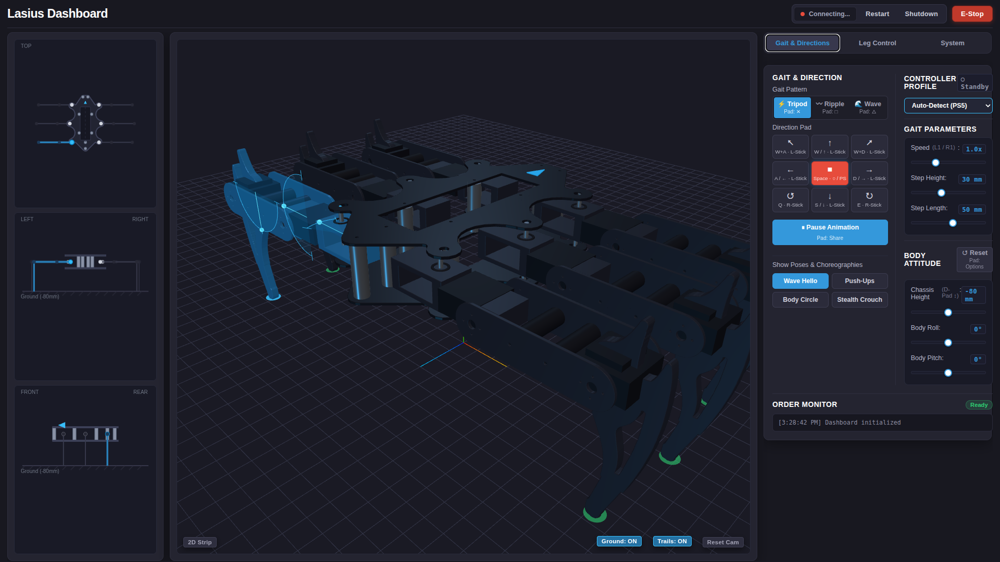
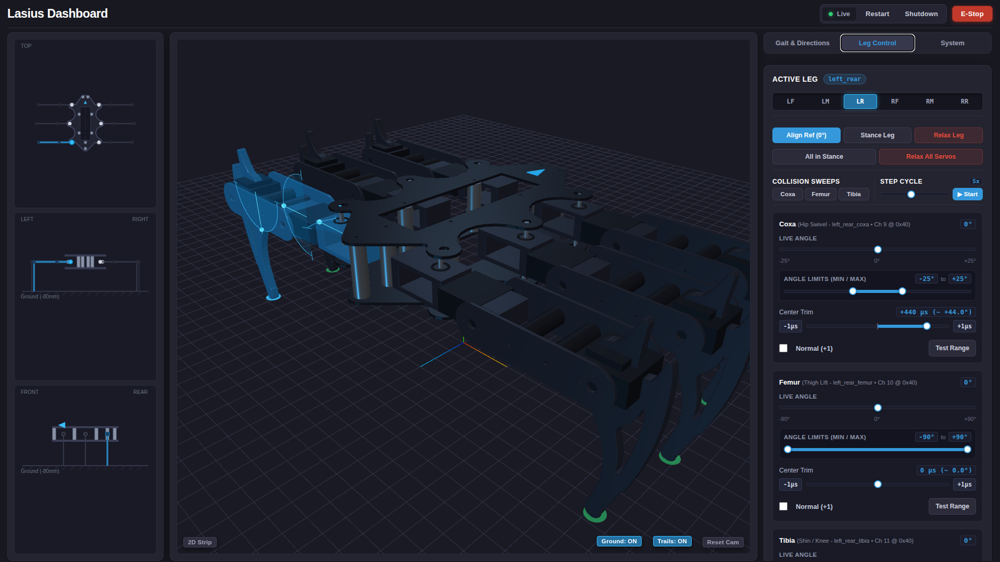
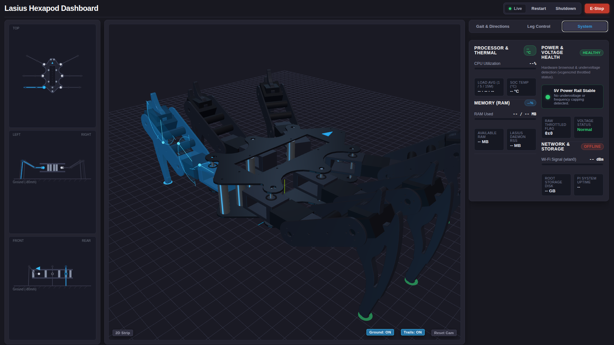

# Lasius Hexapod: lasius-dashboard

---

[Index](../../README.md) | [Software](../../software/README.md) | [Hardware](../../hardware/README.md) | [Docs](../../docs/README.md) | [Data](../../data/README.md) | [Scripts](../../scripts/README.md) |<br>
[lasius-core](../../software/lasius-core/README.md) | [lasius-dashboard](../../software/lasius-dashboard/README.md) | [lasius-pilot](../../software/lasius-pilot/README.md) |

---

<p align="left">
  <a href="https://lasius.kaemmereit.de/"></a>
  <a href="https://github.com/vern-da-coda/lasius/actions/workflows/deploy-demo.yml"></a>
  <a href="https://github.com/vern-da-coda/lasius/actions/workflows/ci.yml"></a>
  <a href="https://github.com/vern-da-coda/lasius/commits/main"></a>
</p>

Modular Vue 3 + TypeScript + Pinia 3D Digital Twin and browser control interface for the **Lasius** 18-DOF Hexapod robot. Built with Vite and Three.js.

**Live Web Demo:** [**https://lasius.kaemmereit.de/**](https://lasius.kaemmereit.de/) – Interactive 3D Digital Twin with real-time browser gait simulation.

<p align="center">
  
</p>

## Live Web Demo & Client Simulation

The dashboard is accessible online at [**https://lasius.kaemmereit.de/**](https://lasius.kaemmereit.de/).

### Additive Simulation Mode (`src/demo/`)
When the dashboard is accessed without an active Raspberry Pi robot connection (e.g. public hosting), it automatically activates a self-contained, client-side kinematics simulation:
- **In-Browser Gait Engine (`demoGaitEngine.ts`):** Complete TypeScript port of the 50 Hz harmonic cosine tripod, ripple, and wave gait generator with $C^1$-continuous foot trajectories.
- **Closed-Form 3-DOF Inverse Kinematics:** Computes exact Coxa, Femur, and Tibia angles using the Law of Cosines for the 60 mm / 100 mm / 130 mm limb geometry.
- **Full Teleoperation Interactivity:** Supports omnidirectional translation, rotation, and 6-DOF body posing (height $-120 \dots -40\,\text{mm}$, roll $\pm 25^\circ$, pitch $\pm 25^\circ$) via:
  - On-screen Direction Pad and slider controls
  - Keyboard hotkeys (`W`/`A`/`S`/`D`, `Q`/`E`, `Space`)
  - USB and Bluetooth gamepads (Sony DualSense, Xbox, Google Stadia)
- **Non-Intrusive Architecture (`useDemoSimulation.ts`):** Implemented as an isolated Vue 3 composable. It stays dormant when connected to a physical robot over WebSocket (`ws://<ip>:8765`), yielding completely to hardware telemetry with zero side effects.

## Architectural Highlights

- **Modern Vue 3 SPA:** Modular Single-File Components using `<script setup lang="ts">` and strict TypeScript interfaces.
- **Pinia State Management (`dashboardStore.ts`):** Unified store managing 50 Hz WebSocket event streaming, REST order dispatching, and bidirectional parameter synchronization.
- **High-Performance Three.js Engine (`LasiusGraphicsEngine.ts`):**
  - Robust Three.js encapsulation using Vue `shallowRef` to prevent reactive proxy overhead.
  - In-place `BufferAttribute` geometry updates for 50 Hz motion-range arcs and foot trajectory curves (zero per-frame memory allocation or garbage collection spikes).
  - Explicit WebGL resource disposal (`geometry.dispose()`, `material.dispose()`) to prevent memory leaks during view transitions.
- **Keyboard Navigation:** Native hotkeys (`WASD`, `QE`, `Arrows`, `Space`) with debounce and `keyup` stop detection.

---

## Views & Viewport System

- **Interactive 3D WebGL Digital Twin:**
  - Full-mesh 3D representation based on physical CAD geometry: dual carbon-fiber sandwich plates, 8 standoff pillars, Coxa brackets, Femur beam cages, and curved Tibia sickles.
  - Consistent PBR metal-roughness materials (`#343746`) with forward-facing orientation chevron (`#3498db`).
  - Full OrbitControls navigation (Left-drag rotate, Right-drag pan, Wheel zoom).
- **Multi-View 2D Orthographic Projections:**
  - Clean CAD orthographic projections using straight kinematic vectors:
    - **Top View (XY Plane):** Robot heading, lateral reach, and coxa swing arcs.
    - **Side View (YZ Plane):** Chassis pitch, body height clearance, and femur/tibia articulation.
    - **Front View (XZ Plane):** Stance width, body roll, and symmetry.

---

## Control Sidebar & Operating Panels

### 1. Gait & Directions Panel
- **Gait Morphing:** Switch dynamically between **Tripod** (fast, dynamic 3-leg alternation), **Ripple** (smooth 4-leg support), and **Wave** (ultra-stable crawling with 5-leg support).
- **Direction Pad:** Holonomic translation (forward, backward, lateral strafe) and in-place rotation with configurable speed, step height, and step length.
- **Body Attitude (6-DOF Posing):** Dynamic chassis clearance height ($-60 \dots -110\,\text{mm}$), roll angle ($\pm 15^\circ$), and pitch angle ($\pm 15^\circ$) with single-click zero-reset.
- **Choreographies & Poses:** Pre-programmed macro sequences including *Wave Hello*, *Push-Ups*, *Body Circle*, and *Stealth Crouch*.
- **Live Order Monitor:** Real-time log of dispatched orders with priority, latency, and execution status.

### 2. Leg Control & Calibration Panel
<p align="center">
  
</p>

- **Interactive 2D Minimap & Leg Selection:** Quick-select any of the 6 legs (`LF`, `LM`, `LR`, `RF`, `RM`, `RR`) with synchronized 3D highlighting in the Digital Twin.
- **Reference Pose & Stance:** *Align Ref (0°)* aligns the selected leg to kinematic zero while relaxing the other 15 servos for isolated mechanical alignment.
- **Microsecond Pulse Trim (Option C Overlay):** High-precision servo endpoint and center-trim calibration with live `[-1µs]` / `[+1µs]` fine-adjustment and test range validation.
- **Joint Safety Limits & Polarity:** Graphical min/max angle constraint sliders and direction inversion toggles (`Normal (+1)` / `Inverted (-1)`).
- **Automated Collision Sweeps & Harmonic Cycles:** Built-in sweeps for Coxa, Femur, and Tibia joints, plus parametrizable multi-cycle step executions.

### 3. System Telemetry & Hardware Health Panel
<p align="center">
  
</p>

- **Processor & Thermal:** Live CPU utilization %, load averages (1/5/15 min), and Raspberry Pi SoC core temperature (°C).
- **Power & Voltage Health:** Real-time hardware undervoltage, frequency throttling, and brownout monitoring via `vcgencmd get_throttled` flags.
- **Memory & Storage:** RAM utilization vs total capacity, daemon resident set size (RSS), and root filesystem disk headroom.
- **Network & Diagnostics:** Wi-Fi RSSI signal strength (dBm), link state, and system uptime.

---

## Global Header Actions

- **Emergency Stop (E-Stop):** Prominent red header button executing Priority-99 E-Stop: immediately halts motion and de-energizes all 18 servos.
- **Restart Server:** Safely relaxes servos, re-executes the daemon via `os.execv`, and polls for automatic reconnection.
- **Shutdown:** Interactive confirmation dialog, relaxes servos, and cleanly executes `sudo shutdown -h now` on the Raspberry Pi.

---

## Development & Build Workflows

### Install Dependencies
```bash
npm install
```

### Local Development Server (Vite HMR)
```bash
npm run dev
```
Serves the development UI at `http://localhost:5173`. Proxies API and WebSocket requests to `http://localhost:8000`.

### Production Build
```bash
npm run build
```
Compiles and bundles optimized static assets into `dist/` (`index.html`, `assets/index-*.js`, `assets/index-*.css`). The Python server daemon in `lasius-core` automatically serves `dist/` directly on port `8000`.
